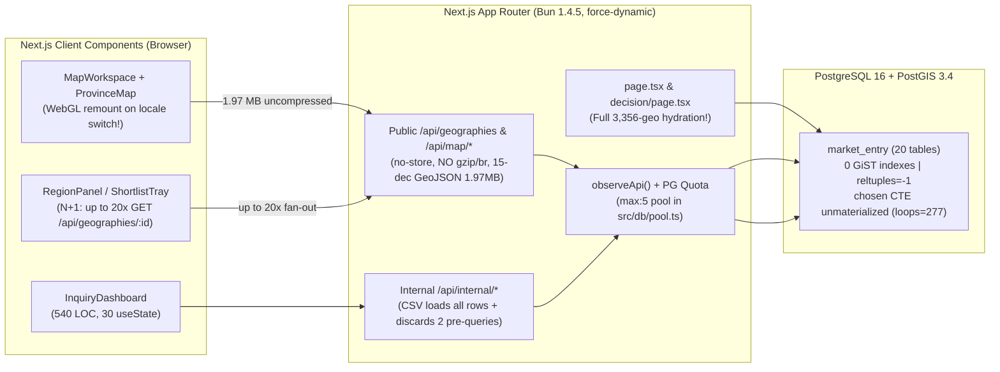

# Báo Cáo Kiểm Toán Kiến Trúc, Chất Lượng Mã Nguồn & Tối Ưu Hóa Hiệu Năng — ECOM

**Hệ thống:** Vietnam Market Intelligence / ECOM (Next.js 15 App Router FE+BE · Bun 1.4.5 · Drizzle ORM 0.45.4 · PostgreSQL/PostGIS 16-3.4)  
**Commit rà soát (`HEAD`):** `45c006b911deaed8f676711dddd3001ace3e8c7e`  
**Commit baseline kiểm toán gốc (`4tzhxjx.zip`):** `d1594867cab6840f2b39ee2d2d602fd435c439a3` (21/11/2026)  
**Tài liệu bàn giao đối chiếu:** `HUONG-DAN-BAN-GIAO-RA-SOAT.md` (sau commit `fc367d6`), `25rz96n (1).docx` (phạm vi B-Lite: 6 trụ cột thị trường, 34 tỉnh / 3.321 xã theo QĐ 19/2025/QĐ-TTg, F01–F07, T01–T06), `docs/acceptance-matrix.md`, `docs/data-dictionary.md`, `docs/openapi.yaml`, `docs/sprint4-release-runbook.md`, `.github/workflows/release-checks.yml`.  
**Dữ liệu đo đạc runtime:** Kế thừa trực tiếp từ phiên kiểm thử độc lập trên PostGIS 16-3.4.3 cô lập & `next start` cục bộ của `@qa-runtime` (báo cáo `#6`, `git status` giữ nguyên, chỉ có `4tzhxjx.zip` untracked).

> **Quy ước nhãn bằng chứng trong báo cáo:**
> - `[Đã xác minh runtime]`: Đã thực thi và xác nhận trực tiếp trên Bun 1.4.5, PostGIS 16-3.4.3, `next build` / `next start`, Playwright hoặc `EXPLAIN (ANALYZE, BUFFERS)` (chi tiết tại Mục 6 và `#6`).
> - `[Phát hiện qua đọc mã]`: Kết luận từ phân tích tĩnh mã nguồn, schema, migration, cấu hình và tài liệu tại commit `45c006b`.
> - `[Chưa xác minh – nêu rõ điều kiện thiếu]`: Hạng mục phụ thuộc hạ tầng staging/production, kiểm thử tải thực tế hoặc thẩm định con người ngoài môi trường local.
> - **Phạm vi công nghệ:** Mọi đề xuất tái cấu trúc và tối ưu hóa bám sát stack hiện hành **PostgreSQL/PostGIS + Drizzle ORM + Bun + Next.js (App Router FE & BE)**, không đề xuất viết lại mang tính hình thức. Báo cáo **không** chứa secret, mật khẩu, token hay nội dung `.env`.

---

## 1. Architecture & Health Scorecard (6 Trục Đánh Giá)

| # | Trục đánh giá | Điểm (/10) | Hiện trạng tổng quan | Điểm mạnh đã xác nhận | Nút thắt / Khoảng trống trọng yếu |
|---|---|---:|---|---|---|
| 1 | **Kiến trúc hệ thống & Tách lớp (Next.js + Feature Modules)** | **7.0 / 10** | `[Phát hiện qua đọc mã]` Cấu trúc theo feature (`src/features/{geography,map,decision,regions,inquiries,releases,shortlist,search,profile}`) khá rõ ràng, giữ ranh giới nghiệp vụ tốt. | Tách biệt rõ public workspace, `/decision`, `/investor-guide`, `/internal/*`; Route Handlers mỏng; dùng transaction `repeatable read read only` cho đọc nhất quán. | Một số RSC (`src/app/page.tsx:9`, `src/app/decision/page.tsx:10`) và search API tải toàn bộ catalog; `InquiryDashboard.tsx` phình to (540 dòng, 30 `useState`); có mã chết chưa nối dây (`src/db/client.ts`, `src/lib/mail.ts`, `InquiryDialog.tsx`, bảng `inquiry_notifications`). |
| 2 | **Tầng Dữ liệu & Tính nhất quán (PostgreSQL/PostGIS + Drizzle)** | **6.5 / 10** | `[Đã xác minh runtime]` + `[Phát hiện qua đọc mã]` Ràng buộc toàn vẹn dữ liệu mức DB rất chặt (CHECK, composite FK, PostGIS validation). | 20 bảng Drizzle, `0000`–`0009` áp dụng sạch trên PostGIS mới (`#6`); ngăn giá trị `unavailable` mang số và khóa chéo `(dataset_version_id, source_id)`. | 100% truy vấn runtime dùng raw `postgres.js` SQL (Drizzle chỉ làm schema/migrator), tồn tại pool thứ 2 chết (`src/db/client.ts`); chưa có chỉ mục GiST & thiếu chỉ mục nóng; chọn cohort (`database-repository.ts` vs `layer-repository.ts`) còn trùng lặp và lệch điều kiện; `operations.ts:113` chặn nhầm mọi chỉ tiêu `score_eligible = true`. |
| 3 | **Đáp ứng nghiệp vụ B-Lite & Chống diễn giải sai (F01–F07, T01–T06)** | **6.0 / 10** | `[Đã xác minh runtime]` + `[Phát hiện qua đọc mã]` Tuân thủ nghiêm ngặt quy tắc chống diễn giải sai (không gán `null` = 0, không suy diễn nhu cầu từ dân số/POI, có refusal gate). | 34 tỉnh / 3.321 xã khớp QĐ 19/2025/QĐ-TTg (`3356` đơn vị, `#6`); so sánh từng hàng (`ECOM-18`); minh bạch trạng thái `unavailable` cho T04/T05 và khu công nghiệp. | T04 chưa có nghiên cứu nhu cầu thật & chưa có schema/UI hiển thị trạng thái `available`; T05 cố định 2 chỉ tiêu ngành bán lẻ, thiếu polarity `lower` và chưa xuất kịch bản; F02 chưa lọc số server-side hay cấp xã; bộ ranh giới còn 57 cặp chồng lấn (~8,92 km²). |
| 4 | **Clean Code, Kiểu dữ liệu & Khả năng bảo trì** | **6.0 / 10** | `[Đã xác minh runtime]` + `[Phát hiện qua đọc mã]` TypeScript strict đạt 0 lỗi (`tsc --noEmit`), không dùng `any`, i18n có khóa kiểm kiểu cứng `Record<MessageKey, string>`. | 0 lỗi `tsc`, 0 lỗi `biome lint`, test đối chiếu placeholder i18n (`i18n.test.ts`), kiểm thử đơn vị sạch và nhanh (293ms). | `format:check` chỉ phủ 3/136 file và **FAIL trên Windows** do CRLF (`.gitattributes` thiếu `*.ts`), toàn repo lệch format **136/136 file**; dòng JSX nén tới 646–714 ký tự; 65 cảnh báo Biome (`59 noNonNullAssertion`), tắt 2 rule a11y (`22` vi phạm tiềm ẩn); `docs/openapi.yaml` thiếu schema phản hồi và lệch tham số. |
| 5 | **Hiệu năng Full-Stack (PostGIS + Bun + Next.js)** | **5.5 / 10** | `[Đã xác minh runtime]` Loopback 1 người dùng phản hồi 20–113ms, nhưng `EXPLAIN ANALYZE` và probe HTTP phơi bày nhiều điểm nghẽn cấu trúc khi mở rộng. | MapLibre tải động (`dynamic import`), First Load JS nhỏ (`103–135 kB`), `test:pilot` 10 vòng pass toàn bộ budget hiện tại. | **0% nén HTTP** trên toàn bộ `/api/*` (`1,97 MB` GeoJSON 15 chữ số thập phân gửi thô mỗi lần tải!); ép `Cache-Control: no-store` lên cả dữ liệu bất biến theo release; full-catalog scan `shared hit=20,350` + `7,788` (`loops=3,356` & `277`); N+1 tới **20 HTTP request** trong `RegionPanel` & `ShortlistTray`; đổi ngôn ngữ VI/EN phá hủy và tải lại toàn bộ WebGL MapLibre. |
| 6 | **Chất lượng tự động, CI/CD & Sẵn sàng vận hành** | **7.5 / 10** | `[Đã xác minh runtime]` + `[Phát hiện qua đọc mã]` Pipeline CI fail-closed xuất sắc, kịch bản `test:release` kiểm soát tốt DB cô lập, runbook chi tiết. | `.github/workflows/release-checks.yml` chạy đủ audit, lint, PostGIS migrate, import, `test:release` (`116+1+19` pass, 0 skip/flaky `#6`), Dockerfile multi-stage non-root `USER bun`. | Ngân sách hiệu năng smoke (`5–8s` p95 localhost) quá lỏng; `Dockerfile` thiếu `HEALTHCHECK` ở stage `production`; `retention-scheduler.ts` chưa xử lý `SIGTERM`; `api-operations.ts:135` nuốt ngoại lệ không log mã lỗi; collector/alert ngoài hệ thống & hạ tầng staging/prod `[Chưa xác minh]`. |

**Tổng điểm sức khỏe kiến trúc & tối ưu: `6.4 / 10` (Phù hợp pilot giới hạn trên hạ tầng được kiểm soát; cần xử lý các nút thắt hiệu năng SQL/HTTP, dọn dẹp Biome/CRLF, và chốt khoảng trống nghiệp vụ B-Lite trước khi mở rộng quy mô).**



---

## 2. Xác Minh Toàn Bộ 34/34 Issues Gốc & 6 Hạng Mục Đã Biết

### 2.1. Tổng hợp độ phủ 34/34 Issues từ `4tzhxjx.zip` (`issues.csv`)

Để đảm bảo không bỏ sót bất kỳ hạng mục nào từ bộ kiểm toán gốc (`commit d159486`):
- **`OPTIMIZE.md` (báo cáo này)** thẩm định trực tiếp **25/25 issue phi-bảo-mật**: `ECOM-06, 07, 08, 09, 10, 11, 12, 13, 14, 15, 17, 18, 19, 20, 21, 22, 23, 24, 27, 28, 30, 31, 32, 33, 34`.
  - **Đã xác minh sửa:** **7** (`ECOM-06, 07, 08, 15, 18, 24, 32`).
  - **Sửa một phần:** **18** (`ECOM-09, 10, 11, 12, 13, 14, 17, 19, 20, 21, 22, 23, 27, 28, 30, 31, 33, 34`).
  - **Còn lỗi hoàn toàn / Chưa xác minh / Không còn áp dụng:** **0** (mọi issue đã có hành động khắc phục sau `d159486` ở các commit `a82dac4`–`45c006b`, nhưng 18 hạng mục vẫn còn khoảng trống kỹ thuật hoặc nghiệp vụ cụ thể nêu chi tiết bên dưới).
- **`PENTEST.md`** thẩm định chuyên sâu **9/9 issue bảo mật / quyền riêng tư / vận hành bảo mật**: `ECOM-01, 02, 03, 04, 05, 16, 25, 26, 29`.
- **Tổng độ phủ:** `25 + 9 = 34 / 34` issue (`ECOM-01` → `ECOM-34`), **0 khoảng trống**.

### 2.2. Bảng xác minh chi tiết 25 Issues phi-bảo-mật tại `HEAD` (`45c006b`)

| ID | Mức độ / Nhóm | Nội dung gốc | Trạng thái (`45c006b`) | Nguồn xác minh | Bằng chứng `file:line` & Kiểm tra hồi quy | Khoảng trống còn lại, Đề xuất & Test bổ sung |
|---|---|---|---|---|---|---|
| **ECOM-06** | P1 · correctness | Tính KPI conversion & response-time từ transition events thay vì `updated_at` | **Đã xác minh sửa** | `[Đã xác minh runtime]` `[Phát hiện qua đọc mã]` | `src/features/inquiries/repository.ts:176-179,194-197` tính `contacted_at`/`qualified_at` bằng `min(a.happened_at)` từ `inquiry_audit` (`action='status_changed'`); `reporting.ts:120-137` dùng hai mốc này và không đếm `new -> closed` là `qualified`. Test DB `tests/db/inquiry.integration.test.ts:144-163` PASS (`#6`). | *Lưu ý ngữ nghĩa:* `validation.ts:29` cho phép chuyển thẳng `new -> qualified`; hiện khi chuyển thẳng, `contacted_at` là `NULL` (nên `qualifiedRate` có thể > `contactedRate`). **Đề xuất:** Tài liệu hóa rõ hoặc dùng `coalesce(contacted_at, qualified_at)` nếu nghiệp vụ xem `qualified` đã bao hàm liên hệ; bổ sung test chuyển `new -> qualified -> closed` kèm thêm note sau 10 ngày. |
| **ECOM-07** | P1 · correctness | Dùng múi giờ Việt Nam (`Asia/Ho_Chi_Minh`) cho xu hướng theo tuần | **Đã xác minh sửa** | `[Đã xác minh runtime]` `[Phát hiện qua đọc mã]` | `src/features/inquiries/reporting.ts:4,66-74` dịch `+7h` trước khi tính ISO week; `repository.ts:205` dùng `to_char(created_at at time zone 'Asia/Ho_Chi_Minh','IYYY-"W"IW')`; `snapshots.ts:5,61` nâng `FORMULA_VERSION = "inquiry-funnel-v4"` và chặn so sánh khác công thức/múi giờ. Test `tests/db/inquiry.integration.test.ts:149,156` (`2026-11-15T17:30:00Z` -> `2026-W47`) PASS (`#6`). | *Lưu ý nhỏ:* `src/db/schema.ts:131-132` vẫn đặt default DB là `'UTC'` và `'inquiry-funnel-v3'` (chỉ nên dùng nếu insert thủ công). **Test bổ sung:** Thêm test ranh giới giao thừa ISO week (31/12 17:30Z -> tuần 1 năm mới ICT). |
| **ECOM-08** | P1 · correctness | Yêu cầu danh tính source/dataset ổn định khi so sánh địa bàn | **Đã xác minh sửa** | `[Đã xác minh runtime]` `[Phát hiện qua đọc mã]` | `src/features/geography/domain.ts:64-67` đối chiếu đủ `source.id`, `datasetVersion`, `dataset?.code`, `dataset?.id`; `database-repository.ts:73,87` gắn `dataset_version_id` vào `dataset.id`. Test `tests/features/comparison.test.ts:47-58` xác nhận từ chối cùng `versionLabel` nhưng khác `source.id` (PASS `#6`). | *Củng cố nhỏ:* `DatasetMetadata.id` tại `src/features/geography/types.ts:33` vẫn khai báo optional (`id?: string`); nếu cả hai observation đều thiếu `dataset`, kiểm tra `dataset?.id` vẫn qua. **Đề xuất:** Chuyển `dataset.id` thành bắt buộc ở runtime DTO và gom chung kiểm tra với `decision/model.ts` & `regions/model.ts`. |
| **ECOM-09** | P1 · correctness | Chọn cohort quan sát nhất quán thay vì lấy bản ghi mới nhất riêng từng địa bàn | **Sửa một phần** | `[Đã xác minh runtime]` `[Phát hiện qua đọc mã]` | `src/features/geography/database-repository.ts:148-175` đã thay `distinct on (geo_id, indicator_id)` bằng CTE `cohorts`/`chosen` chọn 1 cohort duy nhất theo `(indicator_id, level)` sắp xếp `period_end desc, coverage desc, published_at desc`. Test `tests/features/geography/database-repository.test.ts:40-54` PASS (`#6`). | **Thiếu 2 tiêu chí gốc:** (1) Khi phát hành lệch pha (chỉ tỉnh A có 2026, A & B đều có 2025), thứ tự `period_end desc` trước `coverage desc` chọn cohort 2026 (coverage=1) khiến B mất chỉ tiêu và không so sánh được cohort chung 2025; (2) `/api/geographies/[geoId]` và `/api/geographies/compare` chưa có tham số/UI chọn kỳ lịch sử. **Đề xuất:** Thêm tùy chọn `period` hoặc thuật toán chọn cohort chung có độ phủ đầy đủ cho tập `ids` khi gọi `/compare`, kèm test DB phát hành lệch pha. |
| **ECOM-10** | P1 · performance | Tổng hợp dashboard inquiry trong SQL thay vì tải toàn bộ dòng | **Sửa một phần** | `[Đã xác minh runtime]` `[Phát hiện qua đọc mã]` | `src/features/inquiries/repository.ts:172-212` (`inquiryAnalytics`) đã đẩy tính tổng, breakdown và weekly trend xuống PostgreSQL; `src/app/api/internal/inquiries/route.ts:55` dùng `inquiryAnalytics(filters)` cho phản hồi JSON. | **3 tồn đọng hiệu năng:** (1) `route.ts:44-51` khi `format=csv` vẫn chạy `listInquiries` + `countInquiryReportRows` rồi **vứt bỏ**, sau đó gọi `inquiryReportRows()` tải toàn bộ dòng vào RAM không giới hạn & không stream; (2) Request JSON chạy 3 query (`listInquiries`, `countInquiryReportRows`, và `inquiryAnalytics` tuần tự sau dù `inquiryAnalytics` đã có `total`); (3) `repository.ts:176-179` dùng 2 correlated subquery lên `inquiry_audit`, thiếu index `created_at` & `pg_trgm`, chưa benchmark 10k/100k dòng. |
| **ECOM-11** | P1 · business | Triển khai F05: mô hình hỗ trợ quyết định đa tiêu chí minh bạch + quy tắc từ chối | **Sửa một phần** | `[Đã xác minh runtime]` `[Phát hiện qua đọc mã]` | `src/features/decision/model.ts:45-153` (`calculateRetailScore`) và `RetailScenario.tsx:118-139` triển khai trọng số tổng 100%, chuẩn hóa 0–100 min-max, cảnh báo điểm tương đối, và cổng từ chối chặt khi thiếu dữ liệu/chưa duyệt `scoreEligible`/khác nguồn/thiếu bằng chứng nhu cầu. Unit test `tests/features/decision.test.ts` & E2E `retail-scenario.spec.ts` PASS (`#6`). | **Còn thiếu so với DOCX §5.2 & ECOM-11:** (1) `model.ts:135` chỉ hỗ trợ chiều `higher`-is-better, thiếu polarity `lower`; (2) Cứng 2 tiêu chí (`RETAIL_TOTAL`, `LABOR_FORCE`) cho 1 ngành `retail`; (3) Chưa có export kịch bản (JSON/CSV kèm trọng số, nguồn, timestamp); (4) Chưa có test số học chuẩn DOCX A=68.35 / B=69.05; (5) **Hồi quy kiến trúc:** `src/features/releases/operations.ts:113` đánh dấu mọi observation có `indicator.score_eligible = true` là `invalid_observations`, chặn luôn khả năng công bố bộ chỉ tiêu đủ điều kiện chấm điểm trong tương lai! |
| **ECOM-12** | P1 · business | Triển khai F04: hợp đồng bằng chứng needs/wants thật & trạng thái unavailable tường minh | **Sửa một phần** | `[Đã xác minh runtime]` `[Phát hiện qua đọc mã]` | `src/features/decision/model.ts:35-43` định nghĩa kiểu `Evidence` (`status`, `segment`, `geographyIds`, `sampleSize`, `method`, `period`, `source`); `RetailScenario.tsx:112-117` hiển thị tường minh trạng thái chưa có khảo sát nhu cầu bán lẻ (kèm bối cảnh KSMSDC 2025, không suy diễn dân số/POI là nhu cầu). E2E `retail-scenario.spec.ts:34` PASS (`#6`). | **Còn thiếu:** Không có bảng `survey_studies` / `survey_questions` / `survey_aggregates` trong `src/db/schema.ts`; `RetailScenario.tsx:11` hardcode `const noEvidence: Evidence = { status: "unavailable" }`, chưa có API và UI hiển thị luồng `status === "available"` (cỡ mẫu `n`, phương pháp, kỳ, câu hỏi, nguồn) để nghiệm thu đủ hai nhánh T04. |
| **ECOM-13** | P1 · business | Bổ sung F02: bộ lọc ngưỡng số theo chỉ tiêu & xử lý dữ liệu thiếu | **Sửa một phần** | `[Đã xác minh runtime]` `[Phát hiện qua đọc mã]` | Đã triển khai 2 bộ lọc ngưỡng số cấp tỉnh phía client: `LayerControls.tsx:133-150` + `src/features/map/filters.ts` (min/max theo lớp chỉ tiêu đang bật) và `RetailScenario.tsx:54-86` (ngưỡng tối thiểu doanh thu bán lẻ & lực lượng lao động, hiển thị rõ danh sách tỉnh bị loại do thiếu dữ liệu/dưới ngưỡng, không bao giờ gán `null`=0). E2E `map-filter-share.spec.ts` & `retail-scenario.spec.ts` PASS (`#6`). | **Còn thiếu:** `GET /api/geographies` (`src/app/api/geographies/route.ts:7-10`) chỉ nhận `q` và `level`, chưa hỗ trợ lọc ngưỡng số phía server trên cohort đồng nhất; chưa có lọc số cho cấp xã hoặc trong ô tìm kiếm chung (`docs/acceptance-matrix.md:8`). |
| **ECOM-14** | P1 · business | Tạo luồng kịch bản nhà đầu tư theo ngành (sector-first) thay vì chỉ duyệt bản đồ | **Sửa một phần** | `[Đã xác minh runtime]` `[Phát hiện qua đọc mã]` | Đã xây dựng trang `/decision` (`src/app/decision/page.tsx`, `RetailScenario.tsx`) dẫn từ trang chủ (`src/app/page.tsx:18`) theo hành trình: chọn ngành → lọc ngưỡng → so sánh 2–3 tỉnh (có chọn tỉnh mốc so lệch) → xem bằng chứng nhu cầu → kiểm tra chấm điểm → gửi inquiry → checklist. E2E `retail-scenario.spec.ts` PASS (`#6`). | **Còn thiếu:** Mới hỗ trợ cứng 1 ngành `retail`, chưa có bước chọn phân khúc khách hàng (B2C/B2B), chưa có lưu/mở lại kịch bản và chưa có xuất kịch bản kèm nguồn & thời điểm (tiêu chí #3 ECOM-14). |
| **ECOM-15** | P1 · qa | CI bắt buộc cho typecheck, test, migration smoke và production build | **Đã xác minh sửa** | `[Đã xác minh runtime]` `[Phát hiện qua đọc mã]` | `.github/workflows/release-checks.yml:1-84` chạy trên `pull_request` và `push` nhánh `main` với `bun-version: 1.4.5`, `--frozen-lockfile`, `bun audit --audit-level=high`, `lint`, `format:check`, PostGIS `16-3.4` cô lập, `db:migrate`, `db:import`, `db:import:wave2`, `db:check`, `test:release db`, `test:release workflow`, `build`, `test:pilot`, `test:release e2e`. Tái lập cục bộ PASS toàn bộ trừ `format:check` CRLF trên Windows (`#6`). | *Điều kiện ngoài mã nguồn:* `[Chưa xác minh – cần quyền quản trị GitHub]` việc đã bật Branch Protection yêu cầu job `Required release checks` trước khi merge vào `main`. Đồng thời cần mở rộng `format:check` ra toàn repo (liên quan `ECOM-22`). |
| **ECOM-17** | P2 · business | Bổ sung checklist pháp lý & sẵn sàng gia nhập thị trường (chỉ mang tính tham khảo) | **Sửa một phần** | `[Đã xác minh runtime]` `[Phát hiện qua đọc mã]` | `RetailScenario.tsx:141-150` có checklist 4 mục kèm khuyến cáo xác minh với cơ quan có thẩm quyền; `src/app/investor-guide/page.tsx:1-23` cung cấp hướng dẫn 5 bước, 3 liên kết Invest Vietnam, cảnh báo hiệu lực và ngày rà soát (`22/11/2026`). | **Còn thiếu theo tiêu chí ECOM-17:** 4 checkbox trong `RetailScenario.tsx:145-148` là uncontrolled (không lưu trạng thái, không export được), từng mục chưa gắn URL văn bản chính thức / ngày hiệu lực / nhãn `to verify`; hồ sơ tỉnh chưa có dataset khu công nghiệp địa phương đã xác minh (`GeoProfilePanel.tsx:56`). |
| **ECOM-18** | P2 · correctness | Cho phép so sánh các hàng chỉ tiêu tương thích mà không xóa trắng toàn bộ bảng | **Đã xác minh sửa** | `[Đã xác minh runtime]` `[Phát hiện qua đọc mã]` | `src/features/geography/domain.ts:59-88` tính `metadataMatches`, `reason`, `reasonCode` theo từng hàng (`rows`), chỉ đặt `null` cho các hàng không tương thích và giữ nguyên số liệu ở các hàng hợp lệ; `ComparisonPanel.tsx:45` hiển thị từng hàng kèm lý do từ chối. Test `tests/features/comparison.test.ts:47-58` PASS (`#6`). | Giữ nguyên bảo đảm không trộn nguồn thầm lặng; đạt đầy đủ tiêu chí chấp nhận. |
| **ECOM-19** | P2 · data | Hiển thị chất lượng dữ liệu từng giá trị & xuất xứ lớp ngay tại điểm tương tác bản đồ | **Sửa một phần** | `[Đã xác minh runtime]` `[Phát hiện qua đọc mã]` | `src/features/map/layer-repository.ts:62` đã trả `valueDetails[geo_id]` (`quality`, `missingReason`, `method`, `limitations`); `LayerControls.tsx:119,161-169` hiển thị giá trị, kỳ, chất lượng, nguồn, giấy phép, phương pháp, giới hạn trong vùng `aria-live="polite"` khi chọn tỉnh (E2E `published-release.spec.ts:34-37` PASS `#6`). | **Khoảng trống còn lại:** Trên canvas bản đồ (`ProvinceMap.tsx:174-180`), lớp choropleth chưa phân biệt trực quan giữa giá trị `verified` và `supported` (toàn bộ dữ liệu Sprint 1 & Wave 2 hiện đều mang trạng thái `supported`), và nhấp chuột vào tỉnh không mở tooltip/popup lớp đang bật ngay trên bản đồ (chỉ POI sân bay có `Popup` tại `ProvinceMap.tsx:118`). |
| **ECOM-20** | P2 · architecture | Xử lý song song 2 nguồn sự thật về database schema | **Sửa một phần** | `[Phát hiện qua đọc mã]` | `database/market-entry/README.md:1-4` đã bổ sung ghi chú đầu trang tuyên bố thư mục này là "thiết kế và bộ kiểm thử prototype độc lập", còn schema ứng dụng hiện hành là `src/db/schema.ts` + `drizzle/`; `docs/sprint1-data-foundation.md:6` cũng nêu rõ. | **Còn tồn đọng:** Chưa có bảng đối chiếu `entity -> feature` (bảng nào đã chạy runtime vs bảng thiết kế tương lai); `database/market-entry/README.md:17-32` vẫn giữ lệnh PowerShell gắn đường dẫn cục bộ `D:\TMDT` và `D:\postgreSQL` (PG 18.6) dễ gây hiểu nhầm cho người mới. **Đề xuất:** Dời sang `docs/archive/prototype-sql/` hoặc bổ sung bảng ánh xạ thực thể và gỡ đường dẫn máy cá nhân. |
| **ECOM-21** | P2 · architecture | Tái tạo Drizzle metadata snapshot bị thiếu cho migration `0005`/`0006` | **Sửa một phần** | `[Đã xác minh runtime]` `[Phát hiện qua đọc mã]` | `drizzle/meta/` hiện có đủ `0000_snapshot.json` → `0009_snapshot.json` với chuỗi `prevId → id` liền mạch (20 bảng); `bun run db:migrate` áp dụng sạch `0000`–`0009` trên PostGIS mới (`#6`). | **3 điểm lệch còn lại:** (1) `drizzle/0006_inquiry_snapshot_governance.sql:19` đặt tên FK `inquiry_report_snapshot_audit_snapshot_fk`, còn `src/db/schema.ts:144` và `0009_snapshot.json` ghi tên auto-generated >63 ký tự (`inquiry_report_snapshot_audit_snapshot_id_inquiry_report_snapshots_snapshot_id_fk`); (2) Khi chạy `db:migrate`, PostGIS phát **6 `NOTICE (42622)`** cắt ngắn tên constraint >63 ký tự (`#6`); (3) Hàm SQL `protect_inquiry_snapshot_filters(jsonb)` (`0007:21-35`) là DDL ngoài Drizzle — cần quy trình chuẩn hóa migration thủ công và kiểm thử `drizzle-kit generate` no-op trên CI. |
| **ECOM-22** | P2 · quality | Dùng linter/formatter thực sự thay vì đặt tên `tsc` là `lint` | **Sửa một phần** | `[Đã xác minh runtime]` `[Phát hiện qua đọc mã]` | Đã cài `@biomejs/biome` 2.3.8, tạo `biome.json`, bổ sung `biome lint src tests scripts` vào `lint` và thêm `format:check` / `format` (`package.json:11-13`). `bun run lint` PASS (`0` lỗi, `65` warning `#6`). | **4 thiếu sót lớn:** (1) `lint` vẫn gộp `tsc --noEmit && biome lint` (chưa tách `typecheck`); (2) `format:check` chỉ phủ **3/136 file** (`package.json:12`); (3) Trên Windows, `bun run format:check` **FAIL 3/3 file** do CRLF (`.gitattributes` không áp `eol=lf` cho `*.ts`), còn toàn repo FAIL **136/136 file** do `biome.json` thiếu block `formatter` (`indentStyle`/`lineEnding`); (4) Tắt 2 rule a11y tại `biome.json:10-13` (che **22** vi phạm). |
| **ECOM-23** | P2 · performance | Tránh nạp toàn bộ catalog DB trên mỗi request địa bàn nhỏ | **Sửa một phần** | `[Đã xác minh runtime]` `[Phát hiện qua đọc mã]` | `loadDatabaseCatalog(geoIds?, includeObservations)` đã hỗ trợ lọc `geoIds` cho `/api/geographies/[geoId]`, `/compare`, `/export` và bỏ qua observations cho `/api/health` (`[]`, `false`) và `/api/geographies` (`undefined`, `false`). | **Vẫn còn 4 điểm nóng nghiêm trọng đã đo bằng `EXPLAIN ANALYZE` (`#6`):** (1) `src/app/page.tsx:9` & `src/app/decision/page.tsx:10` vẫn gọi `loadPublicCatalog()` **không tham số** (nạp cả 3.356 địa bàn + 273 quan sát, `shared hit=20,350 + 7,788`); (2) `GET /api/geographies` (`route.ts:22`) vẫn tải toàn bộ 3.356 địa bàn vào RAM lọc bằng JS (`19.9 ms`, `20,350 hits`); (3) Query `observations` dù có `geoIds` vẫn quét đủ `eligible`/`cohorts` (`7,788 hits`, `loops=25`..`277`); (4) Không có cache theo release / `ETag` (`api-operations.ts:138` ép `no-store` mọi API). |
| **ECOM-24** | P2 · quality | Ép fail-closed cho test tích hợp DB & E2E có xác thực trong release checks | **Đã xác minh sửa** | `[Đã xác minh runtime]` `[Phát hiện qua đọc mã]` | `scripts/test-release.ts:11-59` kiểm tra chặt tên DB test cô lập (`ecom_inquiry_it_*` / `ecom_sprint4_workflow_*` trên `127.0.0.1`), phân tích JUnit XML và Playwright JSON, trả lỗi ngay nếu `skipped > 0`, `flaky > 0` hoặc `tests == 0`. Đã xác minh chạy PASS thực tế (`#6`: `db` 116/116, `workflow` 1/1, `e2e` 19/19, 0 skip). | Đạt đủ tiêu chí fail-closed cho pipeline phát hành; lưu ý duy trì `bun run test` mặc định chỉ cho vòng lặp dev nhanh (19 skip có điều kiện) và không dùng nó thay cho `test:release`. |
| **ECOM-27** | P2 · ux | Cải thiện điều hướng bàn phím & trình đọc màn hình cho bản đồ và dialog | **Sửa một phần** | `[Đã xác minh runtime]` `[Phát hiện qua đọc mã]` | Đã cải thiện focus visible, thông báo `role="status"`, reduced-motion, mobile viewport (`tests/e2e/sprint4-pilot.spec.ts:6-26` PASS `#6`); thay dialog gửi inquiry trong `GeoProfilePanel.tsx:23` và `ShortlistTray.tsx:89` bằng `<details>` thân thiện bàn phím hơn. | **Còn lỗi/thiếu sót:** (1) `src/features/inquiries/InquiryDialog.tsx:14-23` vẫn tồn tại dưới dạng export với `role="dialog" aria-modal="true"` nhưng **thiếu focus trap, thiếu initial focus, thiếu phím `Escape`, thiếu trả focus** (nên xóa dead code hoặc sửa chuẩn); (2) Chọn tỉnh và bật popup sân bay trực tiếp trên canvas (`ProvinceMap.tsx:98-125`) chưa có danh sách đồng bộ/tương đương bàn phím cho POI sân bay; (3) UAT với screen reader thật (NVDA/VoiceOver) `[Chưa xác minh – cần pilot UAT]`. |
| **ECOM-28** | P2 · data | Thêm cổng hồi quy topo/độ phủ tỉnh & chứng cứ giấy phép nguồn | **Sửa một phần** | `[Đã xác minh runtime]` `[Phát hiện qua đọc mã]` | `tests/features/geography/database-integrity.test.ts:51-79` đã bổ sung test PostGIS kiểm `ST_IsValid`, `ST_IsEmpty`, `ST_SRID=4326`, đếm cặp chồng lấn (`<= 57`), tổng diện tích chồng lấn (`<= 9.0 km²`), và license/citation không rỗng (PASS `#6`). `docs/sprint1-data-foundation.md:51-53` và `docs/acceptance-matrix.md:7` ghi rõ mức nền. | **Còn tồn đọng:** Bộ ranh giới đang ghim vẫn thực sự có **57 cặp tỉnh chồng lấn (`8.9199 km²`)** (`#6`), test mới chặn "không tăng thêm" chứ chưa loại bỏ chồng lấn hay kiểm gap/khoảng hở biên giới và ring orientation trong DB; vẫn chờ đánh giá/chấp thuận chính thức của chủ nguồn COD-AB/Cục Thống kê. |
| **ECOM-30** | P2 · documentation | Công bố ma trận nghiệm thu requirement-to-code & trạng thái phát hành trung thực | **Sửa một phần** | `[Phát hiện qua đọc mã]` | Đã phát hành `docs/acceptance-matrix.md:1-14` liên kết rõ từ `README.md:116`, trình bày trung thực trạng thái từng hạng mục T01–T06, file test tương ứng và các giới hạn còn mở (57 cặp chồng lấn, T04 chưa có khảo sát, T05 chưa đủ điều kiện chấm điểm). | **Còn thiếu so với tiêu chí ECOM-30:** `docs/acceptance-matrix.md` mới lập bảng theo T01–T06, chưa ánh xạ đầy đủ từng yêu cầu bắt buộc F01–F07 → API/UI/schema cụ thể; đồng thời `docs/market-entry-intelligence-build-spec.md` (125 KB) chưa có header phiên bản/ngày/trạng thái phân biệt đặc tả thiết kế với hiện trạng triển khai. |
| **ECOM-31** | P2 · quality | Bổ sung ngân sách hiệu năng thực tế & observability cho hành trình nhà đầu tư | **Sửa một phần** | `[Đã xác minh runtime]` `[Phát hiện qua đọc mã]` | `src/lib/api-operations.ts:141-149` ghi structured JSON log (`api_request`, `data_unavailable`); `scripts/sprint4-smoke.ts` đo `initialPageMs`, `p50Ms`, `p95Ms`, `bytes` cho `/` và 7 API (chạy trong CI `release-checks.yml:80` và PASS `#6`). | **3 khoảng trống:** (1) Budget trong `sprint4-smoke.ts:7,67` quá lỏng (**5.000–8.000 ms** p95 trên localhost, gấp 50–100× thực tế 27–113ms); (2) Chưa có budget cho payload bytes (bản đồ 1.97 MB lọt qua), JS bundle, DB query count, `/decision`, hay tải `10k+` inquiry; (3) `api-operations.ts:135` bắt lỗi trả 503 mà không ghi mã lỗi rút gọn, và collector/alert ngoài hệ thống `[Chưa xác minh]`. |
| **ECOM-32** | P2 · reliability | Xử lý trùng lặp hiếm gặp mã tham chiếu inquiry mà không làm mất yêu cầu | **Đã xác minh sửa** | `[Đã xác minh runtime]` `[Phát hiện qua đọc mã]` | `src/features/inquiries/repository.ts:59-82` dùng `on conflict (reference_code) do nothing returning inquiry_id, reference_code` với vòng lặp tối đa 5 lần thử và chỉ chèn `inquiry_audit` khi insert thành công. Test tích hợp ép trùng mã `tests/db/inquiry.integration.test.ts:101-120` PASS (`#6`). | Đạt đủ tiêu chí chấp nhận; giữ nguyên định dạng `INQ-YYYY-XXXXXXXX`. Nếu sản lượng vượt quy mô pilot lớn, có thể tăng entropy lên 6–8 byte (48–64 bit) cho mã mới mà vẫn giữ tương thích mã cũ. |
| **ECOM-33** | P2 · reliability | Thống nhất chính sách chọn snapshot dữ liệu & hồ sơ dưới một quy tắc release rõ ràng | **Sửa một phần** | `[Đã xác minh runtime]` `[Phát hiện qua đọc mã]` | Đã chia sẻ helper `loadPublishedGeography`, `publishedDatasetColumns`, `publicReleaseConditions` (`database-repository.ts:86-110`) và có test đối chiếu đồng nhất map vs profile (`tests/features/geography/database-repository.test.ts:40-54`, PASS `#6`). | **Vẫn chưa thống nhất thành 1 resolver duy nhất:** (1) Chọn cohort viết 2 lần bằng 2 cơ chế (`database-repository.ts:148-175` SQL vs `layer-repository.ts:30-63,91-92` SQL+JS); (2) `database-repository.ts:160` thiếu điều kiện `geo.valid_from <= current_date and (geo.valid_to is null or geo.valid_to >= current_date)` trong CTE `eligible` (khác `layer-repository.ts:42`); (3) `inquiries/repository.ts:13-33` viết lại `resolveProvenance` thiếu tie-breaker `geography.code desc`; (4) Boundaries xếp theo `published_at desc` (`database-repository.ts:222`) trong khi POIs xếp theo `data_as_of desc, published_at desc` (`layer-repository.ts:76`). |
| **ECOM-34** | P2 · quality | Bổ sung đặc tả OpenAPI & tài liệu thành phần cho Public/Internal API | **Sửa một phần** | `[Phát hiện qua đọc mã]` | Đã có `docs/openapi.yaml` (OpenAPI 3.1.0, 226 dòng) bao phủ tên cả 15 endpoint `/api/*` cùng `operatorToken` Bearer auth và được liên kết từ `README.md:116`. | **Drift & thiếu sót:** (1) Thiếu hoàn toàn `components.schemas` cho cấu trúc JSON trả về; (2) Lệch với Route Handlers thực tế: `GET /api/internal/inquiries` nhận `reference`, `limit` (`route.ts:15-16,27`) nhưng vắng trong `openapi.yaml:102-110`; `POST /api/internal/inquiries/snapshots` nhận `filters.from`/`to` (`route.ts:22-23`) nhưng vắng trong spec; thiếu nhiều mã lỗi (`400/404/405/413/415/429/503`); (3) Chưa có automated contract test xác minh OpenAPI khớp mã nguồn. |

### 2.3. Tham chiếu chéo 9 Issues Bảo mật / Quyền riêng tư / Vận hành bảo mật (hoàn thiện 34/34)

9 hạng mục dưới đây thuộc phạm vi thẩm định chính thức của **`c:\ECOM\PENTEST.md`** (không tự gán trạng thái bảo mật trùng lặp tại đây để tránh mâu thuẫn; các giao điểm về hiệu năng/vận hành của `ECOM-16` và `ECOM-25` được phân tích bổ trợ tại Mục 5.4):

| ID | Mức độ gốc | Phân loại | Nội dung gốc (`issues.csv`) | Nơi thẩm định chính thức |
|---|---|---|---|---|
| **ECOM-01** | P1 | security | Chống spreadsheet formula injection trong CSV inquiry & snapshot | Xem chi tiết tại `PENTEST.md` |
| **ECOM-02** | P1 | security | Thay rate limit chung toàn route bằng quota theo client + global ceiling | Xem chi tiết tại `PENTEST.md` |
| **ECOM-03** | P1 | security | Áp giới hạn byte thân request thực tế (64 KB) cho `POST /api/inquiries` | Xem chi tiết tại `PENTEST.md` |
| **ECOM-04** | P1 | privacy | Đảm bảo retention xóa hiệu quả cả audit note & kho phụ chứa PII | Xem chi tiết tại `PENTEST.md` |
| **ECOM-05** | P1 | privacy | Bổ sung privacy notice & căn cứ xử lý hợp pháp cho inquiry (Luật 91/2025/QH15) | Xem chi tiết tại `PENTEST.md` |
| **ECOM-16** | P1 | operations | Chuyển `Dockerfile` sang production multi-stage image thực thụ | Xem chi tiết tại `PENTEST.md` *(giao điểm vận hành tại Mục 5.4)* |
| **ECOM-25** | P2 | privacy | Tự động hóa, giám sát và chứng minh retention cleanup thay vì chạy CLI thủ công | Xem chi tiết tại `PENTEST.md` *(giao điểm vận hành tại Mục 5.4)* |
| **ECOM-26** | P2 | security | Yêu cầu định danh cá nhân cho operator ở production | Xem chi tiết tại `PENTEST.md` |
| **ECOM-29** | P2 | security | Thiết lập cache private & quy tắc side-effect đồng nhất cho snapshot endpoints | Xem chi tiết tại `PENTEST.md` *(giao điểm cache header tại Mục 5.3)* |

### 2.4. Xác minh 6 hạng mục đã biết trong `HUONG-DAN-BAN-GIAO-RA-SOAT.md` (Mục 5)

| # | Hạng mục đã biết (Bàn giao Mục 5) | Trạng thái tại `45c006b` | Bằng chứng xác minh & Nhận định kỹ thuật |
|---|---|---|---|
| **1** | **57 cặp tỉnh chồng lấn (~8,92 km²)** trong bộ ranh giới cần chủ nguồn đánh giá | **Vẫn còn nguyên ở dữ liệu hiện ghim** `[Đã xác minh runtime]` | Kiểm thử PostGIS của `@qa-runtime` (`#6`) trên `data/sprint1/province-boundaries.json.gz` (SHA-256 `c4970ed2...`, COD-AB v02 giản lược dung sai `0.0008°`) xác nhận chính xác: **34** tỉnh, **0** hình học lỗi, **57 cặp tỉnh chồng lấn** với tổng diện tích **`8.9199 km²`**. Top 5 cặp lớn nhất: Tây Ninh–Đồng Tháp (`0.5414 km²`), Ninh Bình–Hưng Yên (`0.4382 km²`), Lai Châu–Điện Biên (`0.3946 km²`), TP.HCM–Đồng Nai (`0.3865 km²`), Thanh Hóa–Nghệ An (`0.3510 km²`). Test `database-integrity.test.ts:74-75` khóa trần hồi quy `<= 57` cặp và `<= 9.0 km²`, nhưng **chưa có biên bản phê duyệt của chủ nguồn** (`[Chưa xác minh – cần chủ nguồn dữ liệu]`). |
| **2** | **T04 chưa có nghiên cứu nhu cầu thật; T05 chỉ test công thức trên dữ liệu thử, dữ liệu bán lẻ chưa đủ điều kiện chấm điểm** | **Xác nhận đúng thực trạng** `[Đã xác minh runtime]` + `[Phát hiện qua đọc mã]` | `RetailScenario.tsx:11` hardcode `noEvidence: Evidence = { status: "unavailable" }`, giao diện chỉ có nhánh hiển thị thiếu bằng chứng (T04). Với T05, `tests/features/decision.test.ts:6-44` chỉ test công thức trên `demoCatalog` gắn `scoreEligible: true`, còn dữ liệu thực Wave 2 (`import-wave2.ts:42`) đều đặt `score_eligible = false` nên UI từ chối chấm điểm (`retail-scenario.spec.ts:35-38` PASS). **Phát hiện bổ sung quan trọng:** `src/features/releases/operations.ts:113` hiện coi mọi observation có `indicator.score_eligible = true` là `invalid_observations` và chặn phát hành batch — cần sửa trước khi bất kỳ chỉ tiêu thực nào có thể bật T05! |
| **3** | **Giao diện vùng tự chọn:** cấp tỉnh (không có quận), lực lượng lao động ≠ số người có việc làm; cần kiểm thử chọn bản đồ, bàn phím, mobile, thiếu dữ liệu, khác nguồn/kỳ và cộng tổng | **Đúng phạm vi & đúng logic cộng tổng, còn thiếu phủ E2E & có N+1 HTTP** `[Đã xác minh runtime]` + `[Phát hiện qua đọc mã]` | `src/features/regions/model.ts:6-21` chỉ cho phép `level === "province"`, cộng tổng `POP_AVG` và `LABOR_FORCE` chỉ khi không thiếu/không trùng tỉnh và khớp chặt `geographyVersion`, `source.id`, `dataset.id`, `datasetVersion`, `periodStart`, `periodEnd`, `unit`, `scope`, `definition` (phủ unit test `tests/features/region-model.test.ts:1-23` PASS). Bản dịch `en.ts:32` / `vi.ts:34` (`region.scope`) ghi rõ *"Lực lượng lao động không đồng nghĩa số người có việc làm"* và chưa có cấp quận. **Khoảng trống kiểm thử & hiệu năng:** E2E `tests/e2e/regions.spec.ts` chỉ kiểm chọn qua ô tìm kiếm trên desktop, **chưa có E2E** chọn trực tiếp trên canvas bản đồ ở chế độ vùng, màn hình mobile 390px, hay các ca hiển thị thiếu dữ liệu/khác nguồn trên UI; đồng thời `RegionPanel.tsx:47-53` gây **N+1 lên tới 20 request** `/api/geographies/:id`. |
| **4** | **Liên kết Invest Vietnam chỉ tham khảo; chưa có dataset khu công nghiệp địa phương được xác minh** | **Xác nhận đúng thực trạng** `[Phát hiện qua đọc mã]` | `src/app/investor-guide/page.tsx:14-20` dẫn 3 URL Invest Vietnam kèm cảnh báo `guide.sourceCaution` và ngày kiểm tra `22/11/2026` (`en.ts:55,60`, `vi.ts:57,62`). `GeoProfilePanel.tsx:56` hiển thị tường minh `profile.parksUnavailable` (*"Chưa có bộ dữ liệu khu công nghiệp địa phương được xác minh"*) và dẫn liên kết ngoài `investvietnam.gov.vn/en/industrial-zones.pl.html`. Tính hiệu lực pháp lý của nội dung trang đích `[Chưa xác minh – cần cơ quan có thẩm quyền / luật sư]`. |
| **5** | **Lỗi timing E2E luồng bán lẻ** từng xuất hiện trên môi trường xem thử | **Ổn định cục bộ 3/3 lượt, nhưng vẫn còn rủi ro timing tiềm ẩn** `[Đã xác minh runtime]` + `[Phát hiện qua đọc mã]` | Chạy lại `playwright test tests/e2e/retail-scenario.spec.ts --repeat-each=3` đạt **3/3 PASS** (`8.8s` tổng: `2.1s`, `2.0s`, `2.0s`, `#6`). **Điều tra nguyên nhân gốc qua đọc mã:** `src/app/page.tsx:18` dùng thẻ `<a href="/decision">` gây full document load, sau đó `tests/e2e/retail-scenario.spec.ts:9` phải chèn `await page.waitForLoadState("networkidle")` trước `sector.selectOption("retail")` để chờ React hydrate xong `<select>` (nếu không chờ hydration, giá trị chọn sẽ bị React reset về `""`). `networkidle` dễ flakey trên môi trường xem thử có tải mạng chậm hoặc telemetry/CDN phụ — nên thay bằng `next/link` và dấu hiệu sẵn sàng hydration rõ ràng (ví dụ `data-hydrated="true"` hoặc chờ phần tử phản hồi với retry tự động của `expect().toPass()`). |
| **6** | **Thu thập log & cảnh báo ngoài hệ thống** không thể chứng minh chỉ bằng structured log và health check trong code | **Xác nhận chưa có bằng chứng triển khai ngoài code** `[Chưa xác minh – thiếu hạ tầng staging/production]` | Trong code đã có structured JSON log (`api_request`, `data_unavailable` tại `src/lib/api-operations.ts:141-149`), `/api/health`, và CLI giám sát retention (`bun run db:retention:monitor` tại `src/db/cleanup-inquiries.ts:11-18`). Tuy nhiên `docs/sprint4-release-runbook.md:43,110` vẫn đánh dấu `[ ]` chưa cấu hình managed PostGIS, TLS, log collector và alert routing trên staging/production — cần xác nhận bằng kịch bản kích hoạt cảnh báo thật khi dựng staging. |

---

## 3. Kiến Trúc & Đề Xuất Refactor (Next.js App Router + Bun + Drizzle ORM + PostGIS)

### 3.1. Phân tích ranh giới kiến trúc hiện tại

Hệ thống tổ chức theo chiều dọc `src/features/*`, tuy nhiên có **5 vết nứt ranh giới** gây trùng lặp, rủi ro hồi quy và nghẽn hiệu năng:

1. **Drizzle ORM chỉ dùng làm Schema-as-Code & Migrator, 100% truy vấn runtime bỏ qua Drizzle & tồn tại DB client chết (`[Phát hiện qua đọc mã]`):**
   - `src/db/client.ts:1-9` khởi tạo `postgres(env.DATABASE_URL, { max: 5, prepare: false })` riêng (thiếu hoàn toàn `connect_timeout`, `statement_timeout`, `lock_timeout`, `idle_in_transaction_session_timeout` so với `src/db/pool.ts:6-16`) và xuất `export const db = drizzle(client, { schema })` — nhưng **0 file** trong toàn repo import `src/db/client.ts`.
   - `@neondatabase/serverless` (`package.json:31`, resolved `1.2.1`) có **0 import** trong toàn repo (`#6`).
   - Toàn bộ truy vấn runtime nằm trong raw SQL `postgres.js` (`database-repository.ts`, `layer-repository.ts`, `inquiries/repository.ts`, `inquiries/snapshots.ts`, `releases/operations.ts`), nên khi đổi tên cột hoặc đổi constraint trong `src/db/schema.ts`, `tsc --noEmit` **không bắt được lỗi sai cột SQL**.
2. **Mã nguồn & Bảng DB "nửa chừng" chưa kết nối (`[Phát hiện qua đọc mã]`):**
   - Bảng `market_entry.inquiry_notifications` (`src/db/schema.ts:93-110`, `drizzle/0009_inquiry_notifications.sql`) và `src/lib/mail.ts:1-56` (nhắc tới script `bun run mail:flush` không hề tồn tại trong `package.json`) có **0 lời gọi** từ `POST /api/inquiries` hay bất kỳ CLI nào.
   - `src/features/inquiries/InquiryDialog.tsx:1-24` không được import ở đâu (đã thay bằng `<details>` trong `GeoProfilePanel.tsx:23` và `ShortlistTray.tsx:89`), nhưng vẫn mang lỗi a11y nghiêm trọng.
3. **Mâu thuẫn nghiệp vụ giữa Release Operations và Decision Support (`[Phát hiện qua đọc mã]`):**
   - `src/features/releases/operations.ts:113` chứa điều kiện `or indicator.score_eligible` trong bộ đếm `invalid_observations` — bất kỳ bộ dữ liệu tương lai nào bật `score_eligible = true` để phục vụ T05 (`decision/model.ts:103`) sẽ bị từ chối duyệt/công bố tại `operations.ts:167-169`! Ngoài ra cùng dòng 113 kiểm `(value_numeric is null) <> (quality_status = 'unavailable')` làm sai lệch nếu sau này có chỉ tiêu dạng `text`/`category` (được `schema.ts:353` cho phép).
4. **Phân mảnh chính sách chọn Release & Cohort (`[Phát hiện qua đọc mã]`):**
   - `resolveProvenance` (`src/features/inquiries/repository.ts:13-33`) lặp lại SQL của `loadPublishedGeography` (`database-repository.ts:97-110`) nhưng thiếu tie-breaker `geography.code desc`.
   - Logic chọn cohort quan sát tồn tại ở 2 nơi độc lập (`database-repository.ts:148-175` vs `layer-repository.ts:30-63,91-92`), trong đó `database-repository.ts:160` thiếu bộ lọc `geo.valid_from <= current_date and (geo.valid_to is null or geo.valid_to >= current_date)`.
   - Tiêu chí ưu tiên dataset khác nhau: boundaries ưu tiên `published_at desc` (`database-repository.ts:222`), POIs ưu tiên `data_as_of desc, published_at desc` (`layer-repository.ts:76`).
5. **Nhân bản quy tắc đối chiếu khả năng so sánh dữ liệu ở 3 module (`[Phát hiện qua đọc mã]`):**
   - Quy tắc so khớp `(source.id, dataset.id, datasetVersion, periodStart, periodEnd, unit, scope, definition)` bị viết lặp 3 lần tại `src/features/geography/domain.ts:64-70`, `src/features/decision/model.ts:110-120`, và `src/features/regions/model.ts:13,20` với 2 sai khác nhỏ: `domain.ts:66` có kiểm `dataset?.code` (hai nơi kia không), còn `regions/model.ts:13` bắt buộc `first.dataset?.id` khác rỗng (trong khi `domain.ts:67` cho phép cả hai cùng `undefined`).

### 3.2. Danh sách đề xuất Refactor cụ thể (đúng stack, đo được lợi ích, rõ rủi ro)

| Mã | Mục tiêu & Vị trí (`file:line`) | Đề xuất tái cấu trúc (PostgreSQL/PostGIS + Drizzle + Bun + Next.js) | Lợi ích đo được | Rủi ro hồi quy & Biện pháp kiểm soát |
|---|---|---|---|---|
| **RF-01** | Hợp nhất tầng DB & xóa dead client/dependency (`src/db/client.ts:1-9`, `src/db/pool.ts:6-16`, `package.json:31`) | Xóa `@neondatabase/serverless` khỏi `package.json`; gộp `db` trong `src/db/client.ts` dùng chung `databasePool()` (để kế thừa toàn bộ timeout 4s/8s/3s/10s) và chuyển dần các truy vấn CRUD chuẩn (inquiries, snapshots, release audit, geo lookup không gian đơn giản) sang Drizzle query builder, giữ raw `sql<...>` có kiểu cho PostGIS (`ST_AsGeoJSON`, `ST_Covers`, `ST_Relate`). | Loại bỏ nguy cơ mở nhầm pool thứ 2 không timeout; giảm dependency thừa; tăng type-safety cột/bảng trực tiếp khi đổi `schema.ts`. | **Thấp:** chuyển từng repository một; chạy đầy đủ `bun run test:release db` + `workflow` sau mỗi repository. |
| **RF-02** | Thống nhất `PublishedReleaseResolver` (`src/features/geography/database-repository.ts:86-175`, `src/features/map/layer-repository.ts:25-92`, `src/features/inquiries/repository.ts:13-33`) | Tách `src/features/geography/release-resolver.ts` cung cấp 1 nguồn sự thật cho: (a) `loadPublishedGeography(tx)` (dùng chung cho cả `resolveProvenance`), (b) `resolvePublishedCohorts(tx, { level, geoIds?, periodEnd? })` có chung bộ lọc `valid_from/valid_to`, và (c) chuẩn hóa chính sách sắp xếp `data_as_of desc, published_at desc, dataset_version_id` cho mọi dataset. Cho phép `/compare` nhận tùy chọn kỳ hoặc ưu tiên cohort chung đủ độ phủ khi phát hành lệch pha (`ECOM-09`). | Đảm bảo 100% đồng nhất vintage giữa Map, Profile, Compare và Inquiry provenance; mở đường so sánh cohort lịch sử. | **Trung bình:** có thể đổi cohort mặc định khi có phát hành lệch pha. Cần test tích hợp DB với dữ liệu lệch pha 2025/2026 (`tests/features/geography/database-repository.test.ts`). |
| **RF-03** | Sửa cổng kiểm tra `score_eligible` & `value_type` trong Release Operations (`src/features/releases/operations.ts:111-114`) | Gỡ `or indicator.score_eligible` khỏi `invalid_observations` (chỉ kiểm tra ràng buộc khớp `schema.ts:318`: `indicator.polarity = 'context_only' and indicator.score_eligible`), và sửa điều kiện null cho tương thích kiểu `text`/`category` theo đúng `observations_value_check` (`schema.ts:351-358`). | Gỡ điểm nghẽn kiến trúc chặn hoàn toàn T05 trên dữ liệu thực khi có chỉ tiêu được phê duyệt chấm điểm. | **Thấp:** kiểm bằng `tests/db/release-workflow.integration.test.ts` + thêm case staging 1 chỉ tiêu `score_eligible = true, polarity = 'higher'`. |
| **RF-04** | Hợp nhất quy tắc tương thích quan sát (`src/features/geography/domain.ts:64-70`, `decision/model.ts:110-120`, `regions/model.ts:13,20`) | Tạo hàm thuần `checkObservationComparability(reference, candidate)` trong `src/features/geography/comparability.ts` đối chiếu thống nhất `source.id`, `dataset.id` (bắt buộc ở runtime), `dataset.code`, `datasetVersion`, `periodStart`, `periodEnd`, `unit`, `scope`, `definition`. Gọi dùng chung ở `compareProfiles`, `calculateRetailScore`, `regionMetric`, `compatibleRegionMetrics`. | Xóa hoàn toàn 3 bản sao logic, chặn drift giữa Compare / Decision / Custom Region. | **Thấp:** test đơn vị có sẵn (`comparison.test.ts`, `decision.test.ts`, `region-model.test.ts`) phủ trực tiếp. |
| **RF-05** | Đồng bộ Drizzle schema/metadata & dọn mã chết (`src/db/schema.ts:93-110,131-144`, `drizzle/0006`, `src/lib/mail.ts`, `src/features/inquiries/InquiryDialog.tsx`, `database/market-entry/`) | (1) Đặt tên FK ngắn (<63 ký tự) tường minh bằng `foreignKey({ name: ... })` trong `schema.ts` để triệt 6 `NOTICE (42622)` và khớp `0006` (`inquiry_report_snapshot_audit_snapshot_fk`); (2) Đồng bộ `formula_version` default lên `inquiry-funnel-v4` ở migration tới; (3) Quyết định rõ cho `inquiry_notifications` + `src/lib/mail.ts`: hoặc hoàn thiện nối dây + thêm `mail:flush`, hoặc gỡ bỏ; (4) Xóa dead code `InquiryDialog.tsx` (hoặc triển khai `<dialog>` chuẩn HTML); (5) Dời `database/market-entry/` vào `docs/archive/prototype-sql/` kèm bảng ánh xạ entity runtime vs future. | Loại bỏ nhiễu kiến trúc, hết cảnh báo PostgreSQL khi migrate, `drizzle-kit generate` tin cậy. | **Trung bình (với rename FK):** cần kiểm tra trên DB đã migrate thực tế trước khi chạy `ALTER TABLE ... RENAME CONSTRAINT` để không làm gãy môi trường đã triển khai. |
| **RF-06** | Tách God Component `InquiryDashboard.tsx` (`src/features/inquiries/InquiryDashboard.tsx:1-540`) | Tách thành 5 module trong `src/features/inquiries/dashboard/`: `useStewardApi.ts` (fetch an toàn `.json().catch(() => null)`, quản lý `busy/error/notice`), `InquiryFilterBar.tsx`, `InquiryListPanel.tsx`, `InquiryDetailPanel.tsx`, `SnapshotReportsPanel.tsx` (gồm lịch sử + so sánh). | Giảm component 540 dòng / 30 `useState` xuống các thành phần <150 dòng dễ test, sửa lỗi parse HTML 502 ở dòng 219 & 301, ổn định `previewKey` qua nửa đêm ICT (dòng 82). | **Thấp–Trung bình:** giữ nguyên `aria-label`, `data-testid`, role để `tests/e2e/investor-inquiry.spec.ts` chạy pass 100%. |

---

## 4. Kiểm Toán Clean Code, Khả Năng Bảo Trì & Công Cụ CI

### 4.1. Thống kê kích thước tệp (LOC) và độ nén dòng bất thường

Đo trực tiếp trên toàn bộ 89 tệp trong `src/` (`88` `.ts`/`.tsx` + `1` `.css`) tại `45c006b` (`[Phát hiện qua đọc mã]`):

| Tệp (`src/...`) | Số dòng | Kích thước | Độ dài dòng tối đa | Số dòng >160 ký tự | Đánh giá maintainability |
|---|---:|---:|---:|---:|---|
| `src/features/inquiries/InquiryDashboard.tsx` | **540** | 32,028 B | 453 | 17 | **God Component** (30 `useState`, gộp 6 trách nhiệm, 2 chỗ `response.json()` thiếu `.catch`). |
| `src/lib/i18n/en.ts` & `vi.ts` | **524** × 2 | 30.4 / 35.1 KB | 334 / 351 | 11 / 7 | Từ điển phẳng đơn tệp lớn; an toàn kiểu nhưng khó mở rộng khi thêm ngành mới. |
| `src/app/globals.css` | **417** | 23,631 B | — | — | Gộp toàn bộ CSS công khai + nội bộ + print; có 4 cảnh báo `noImportantStyles` (`#6`). |
| `src/db/schema.ts` | **359** | 21,076 B | 224 | 7 | Khá sạch nhưng nên tách theo domain (`catalog.ts`, `inquiries.ts`, `operations.ts`) khi bổ sung bảng survey/scenario. |
| `src/features/inquiries/repository.ts` | **303** | 16,646 B | 249 | 5 | Lặp lại mệnh đề `WHERE` động ở 4 hàm (`listInquiries`, `inquiryReportRows`, `inquiryAnalytics`, `countInquiryReportRows`). |
| `src/features/releases/operations.ts` | **269** | 14,784 B | — | — | Truy vấn `readDatasets` dài 75 dòng nhiều `LEFT JOIN LATERAL`; có bug `indicator.score_eligible` ở dòng 113. |
| `src/features/geography/database-repository.ts` | **245** | 12,706 B | — | — | Tải full catalog mặc định; lồng subquery `geo_boundaries` 3 cấp. |
| `src/features/map/ProvinceMap.tsx` | **217** | 10,283 B | — | — | Trộn khởi tạo MapLibre, DOM popup thủ công, 4 `useEffect` (dòng 159 lệ thuộc `[t]` gây remount). |
| `src/features/decision/RetailScenario.tsx` | **153** | 11,380 B | 437 | 11 | Nén JSX dày đặc; lặp `.find()` 4 lần cho cùng chỉ tiêu trong vòng lặp render bảng (`lines 96-101`). |
| `src/features/regions/RegionPanel.tsx` | **94** | 7,271 B | **646** | 7 | Cực kỳ khó đọc & diff (nhiều dòng >400–646 ký tự); N+1 HTTP fan-out. |
| `src/features/shortlist/ShortlistTray.tsx` | **96** | 4,875 B | **665** | 2 | Dòng 86 dài 665 ký tự; N+1 HTTP không `AbortController`. |
| `src/features/comparison/ComparisonPanel.tsx` | **48** | 3,221 B | **714** | 3 | Dòng 45 dài 714 ký tự (toàn bộ `<table>` nén trên 1 dòng!). |

### 4.2. Các "Code Smells" & Trùng lặp cụ thể cần xử lý

1. **Lặp logic đọc body JSON giới hạn kích thước & lỗ hổng nhất quán (`[Phát hiện qua đọc mã]`):**
   - `src/lib/http.ts:19-57` đã có `readBoundedJson(request, maxBytes)` chuẩn (kiểm `content-type`, `content-length`, stream byte limit, UTF-8 `fatal: true`).
   - Thế nhưng `src/app/api/internal/releases/route.ts:29-53` lại tự viết lại vòng lặp `reader.read()` dài 25 dòng (thiếu kiểm `content-length` và `fatal: true`), còn `src/app/api/internal/inquiries/[referenceCode]/route.ts:28-30` gọi thẳng `await request.json()` **không giới hạn byte**! **Đề xuất:** Chuẩn hóa mọi endpoint `POST`/`PATCH` dùng chung `readBoundedJson()`.
2. **Validation UUID không nhất quán (`[Phát hiện qua đọc mã]`):**
   - `snapshots/export/route.ts:8`, `snapshots/compare/route.ts:8`, `releases/route.ts:10` dùng `z.uuid()` (Zod v4), trong khi `inquiries/validation.ts:19` và `snapshots/route.ts:15,24` dùng `z.string().uuid()` (deprecated style ở Zod v4), và nghiêm trọng nhất: `src/app/api/internal/inquiries/route.ts:32` dùng regex lỏng `/^[0-9a-f-]{36}$/i` (chấp nhận cả chuỗi 36 dấu gạch ngang `"---..."`, đẩy xuống Postgres gây lỗi cast `uuid[]` trả 503 thay vì 400!). **Đề xuất:** Dùng thống nhất `z.uuid()` hoặc `uuidPattern` (`src/lib/api-operations.ts:18`) trên toàn bộ Route Handlers.
3. **59 cảnh báo `noNonNullAssertion` & xử lý JSON lỗi không đồng đều (`[Đã xác minh runtime]` `#6`):**
   - Không có `any` trong `src/`, nhưng Biome ghi nhận **59 cảnh báo `!`** (tập trung ở `decision/model.ts`: 12, `geography/domain.ts`: 9, `InquiryDashboard.tsx`: 4, `import-release.ts`: 3). Có thể loại bỏ sạch bằng thu hẹp kiểu (`filter` type guard hoặc biến cục bộ) để tăng độ an toàn runtime.
   - `InquiryDashboard.tsx:219,301` và `ReleaseDashboard.tsx:76,81` gọi `await response.json()` không có `.catch(() => null)` — nếu reverse proxy trả trang HTML 502/504, UI sẽ hiển thị lỗi thô `Unexpected token '<'` thay vì thông báo bản địa hóa.
4. **Hành vi nhỏ không đồng nhất giữa các tiện ích (`[Phát hiện qua đọc mã]`):**
   - CSV xuống dòng: `src/features/shortlist/export.ts:29` nối dòng bằng `"\n"`, trong khi `inquiries/reporting.ts:144` và `snapshots.ts:87` dùng chuẩn RFC 4180 `"\r\n"` kèm `\r\n` cuối tệp.
   - Điều hướng nội bộ: chỉ `src/app/privacy/inquiries/page.tsx:23` dùng `<Link>` của `next/link`; 5 trang/component điều hướng trong cùng tab (`src/app/page.tsx:18-19`, `decision/page.tsx:16`, `investor-guide/page.tsx:6,13`, `GeoProfilePanel.tsx:57`, `ReleaseDashboard.tsx:99`) dùng thẻ `<a href>` gây full page reload (còn liên kết nội bộ thứ 6 tại `InquiryForm.tsx:62` mở `/privacy/inquiries` bằng `<a target="_blank" rel="noopener noreferrer">`, hợp lý cho tab mới).
   - `src/lib/i18n/index.ts:34-57` tạo mới `new Intl.NumberFormat(...)` và `new Intl.DateTimeFormat(...)` trên mỗi lần format thay vì cache theo `locale`; `ReleaseDashboard.tsx:145` gọi `new Date(entry.at).toLocaleString()` bỏ qua ngôn ngữ/múi giờ của `useI18n()`.
   - `src/features/inquiries/repository.ts:145-151,161-167,181-187,218-224` lặp nguyên khối 7 điều kiện lọc `WHERE` ở 4 hàm khác nhau — dễ lệch bộ lọc khi thêm tiêu chí mới; nên trích thành helper `inquiryWhereClause(sql, filters)`.

### 4.3. Kiểm toán OpenAPI (`docs/openapi.yaml`) vs Route Handlers thực tế

Đối chiếu toàn bộ **15 route** trong `src/app/api/**` với `docs/openapi.yaml` (`[Phát hiện qua đọc mã]`):

| Endpoint | Trạng thái khớp OpenAPI | Drift / Thiếu sót cụ thể |
|---|---|---|
| `GET /api/internal/inquiries` | **Lệch tham số** | Code (`src/app/api/internal/inquiries/route.ts:15-16,27`) nhận thêm `reference` và `limit`, nhưng `docs/openapi.yaml:102-110` bỏ sót cả hai. |
| `POST /api/internal/inquiries/snapshots` | **Lệch schema & mã lỗi** | Code (`snapshots/route.ts:22-23`) chấp nhận `filters.from`, `filters.to` (rồi bỏ ở `canonicalSnapshotInput`); `openapi.yaml:163-168` thiếu hai field này và thiếu `400`, `413`, `415`, `500`; `PATCH`/`DELETE` trả `405` chưa khai báo. |
| `POST /api/internal/inquiries/snapshots/{export,compare}` | **Thiếu phương thức & lỗi** | Thiếu khai báo `GET -> 405`, `400`, `404`, `413`, `415`, `429`. |
| `GET/POST /api/internal/releases` | **Thiếu mã lỗi** | Thiếu `400`, `401`, `409`, `413`, `415`, `429`, `503`. |
| Toàn bộ 15 routes | **Thiếu response schema & contract test** | `docs/openapi.yaml` chưa có mục `components.schemas` (toàn bộ response chỉ là `description` chữ thường) và chưa có bài test tự động kiểm tra OpenAPI khớp Route Handlers/Zod. |

### 4.4. Kiểm toán Accessibility, Biome & Kế hoạch Mở rộng CI

- **Lỗi CRLF Windows & phạm vi `format:check` cực hẹp (`[Đã xác minh runtime]` `#6`):**
  - `package.json:12` chỉ format-check **3 file** (`authorization.ts`, `decision/model.ts`, `operator-identity.test.ts`).
  - Do `.gitattributes:1-4` chỉ ép `eol=lf` cho `data/sprint1/*.json` & `data/sprint3/*.json`, trên Windows (`core.autocrlf=true`) ngay cả `bun run format:check` mặc định cũng **FAIL 3/3 file** vì CRLF (`biome format --line-ending=crlf` trên 3 file đó lại **PASS (exit 0, 6ms)** `#6`).
  - Chạy `biome format src tests scripts` toàn repo FAIL **136/136 file** (`#6`) vì `biome.json` không có khối `"formatter"` nên mặc định dùng **tab + LF + lineWidth 80**, trái ngược với 98% codebase (2 spaces + dòng dài).
- **2 rule a11y bị tắt trong `biome.json:10-13` (`[Đã xác minh runtime]`):**
  - Khi thử bật lại (`biome lint --only=a11y/useSemanticElements --only=a11y/noNoninteractiveTabindex`), ghi nhận chính xác **22 lỗi**:
    - `20` lỗi `a11y/useSemanticElements` (phần lớn là `<p role="status">` gợi ý đổi sang `<output>` và 2 thẻ `<div role="region">`).
    - `2` lỗi `a11y/noNoninteractiveTabindex` tại `InquiryDashboard.tsx:471,516` (`<div className="inquiry-report-scroll" role="region" tabIndex={0}>` — thực chất đây là mẫu WCAG hợp lệ để cuộn bảng bằng bàn phím, nên giữ `biome-ignore` có lý do ngay tại 2 dòng đó thay vì tắt rule toàn cục!).
- **Kế hoạch Rollout Biome & CI an toàn (3 bước, không trộn PR nghiệp vụ):**
  1. **Bước 1 (< 1 giờ):** Bổ sung `* text=auto eol=lf` vào `.gitattributes` (giữ `*.gz -text`), thêm khối `"formatter": { "enabled": true, "indentStyle": "space", "indentWidth": 2, "lineWidth": 100, "lineEnding": "lf" }` vào `biome.json`, tách rõ `typecheck` (`tsc --noEmit`), `lint` (`biome lint src tests scripts`), `format:check` (`biome format src tests scripts`) trong `package.json`.
  2. **Bước 2 (1 PR format thuần túy):** Chạy `biome format --write src tests scripts` trong **1 commit duy nhất** không đổi logic, thêm commit SHA đó vào `.git-blame-ignore-revs` để giữ lịch sử `git blame` sạch.
  3. **Bước 3 (Bật lại rule a11y & siết warning):** Bật lại `noNoninteractiveTabindex` (gắn `biome-ignore` cục bộ cho 2 bảng cuộn ở `InquiryDashboard.tsx:471,516`), xử lý dần 20 `<p role="status">` → `<output>` (hoặc giữ rule mức `warn` nếu cần giữ CSS/test role `status` — lưu ý `<output>` trong ARIA có implicit role `status` nên tương thích tốt với Playwright `getByRole("status")`!), giảm 59 `noNonNullAssertion` về 0.
- **Đánh giá `.github/workflows/release-checks.yml`:** Pipeline hiện tại đã rất vững (fail-closed đầy đủ từ `db:migrate` đến `test:release e2e` và `test:pilot`). Khuyến nghị bổ sung thêm 3 bước nhẹ: (a) tách bước `bun run typecheck` và `bun run lint`; (b) chạy kiểm tra `drizzle-kit generate --dry-run` (hoặc kiểm không phát sinh migration thừa); (c) thêm kiểm tra ngưỡng kích thước payload & `bun audit` cảnh báo moderate (`esbuild@0.18.20` trong `drizzle-kit`).

---

## 5. Kiểm Toán Hiệu Năng (PostGIS + Drizzle + Bun + Next.js) & Sẵn Sàng Vận Hành

> **Lưu ý phương pháp đo:** Mọi con số runtime dưới đây lấy từ đo đạc loopback trên máy local của `@qa-runtime` (`#6`: Next.js `15.5.29` standalone trên Bun `1.4.5`, PostGIS `16-3.4.3` Docker, 34 tỉnh / 3.321 xã / 273 quan sát / 22 sân bay, 10 vòng đồng thời 7 endpoint). Kết quả local dùng để **chẩn đoán nút thắt và so sánh trước/sau**, không phải cam kết SLA production.

### 5.1. Số liệu Baseline đã đo (`[Đã xác minh runtime]` `#6`)

#### A. Kích thước Build & Bundle (`bun run build`, tổng 36.4s / compile 4.2s)
- **Shared First Load JS:** `103 kB` · **Middleware:** `34.2 kB`
- **Route First Load JS (toàn bộ `ƒ` dynamic):** `/` `135 kB` (page `13.4 kB`), `/internal/inquiries` `128 kB`, `/decision` `127 kB`, `/internal/releases` `124 kB`, `/privacy/inquiries` `107 kB`, `/investor-guide` `103 kB`.
- **Static & Standalone trên đĩa:** `.next/static` = `2.56 MiB`, `.next/standalone` = `59.8 MiB`. Tài sản tĩnh lớn nhất: chunk MapLibre tải động `1.01 MiB`, `maplibre-gl-worker` `528 KiB`, `framework` `219 kB` (`213.9 KiB`), CSS toàn cục `71.7 kB` (chứa luôn `maplibre-gl.css` nhúng từ `src/app/layout.tsx:2` sang mọi route không có bản đồ!).

#### B. Độ trễ, kích thước phản hồi & HTTP Headers trên Loopback (`next start`, 10 vòng đồng thời)

| Endpoint | p50 | p95 | Kích thước dây (wire) | `Content-Encoding` (với `Accept-Encoding: gzip, br`) | `Cache-Control` hiện tại | Vấn đề phát hiện |
|---|---:|---:|---:|---|---|---|
| `GET /` (HTML) | — | **79 ms** (1 lần) | 8,813 B | `gzip` | `private, no-cache, no-store...` | Nạp toàn bộ 3.356 địa bàn + 273 obs chỉ để đếm 34 tỉnh (`page.tsx:9`). |
| `GET /api/health` | 20 ms | 27 ms | 84 B | **`null` (không nén)** | `no-store` | Chạy thừa query `geo_units` rỗng (`health/route.ts:11`). |
| `GET /api/geographies?q=ha+noi&level=province` | 74 ms | 87 ms | 1,303 B | **`null`** | `no-store` | Tải đủ 3.356 địa bàn (`shared hit=20,350`) vào RAM để lọc bằng JS! |
| `GET /api/geographies/:id` | 44 ms | 97 ms | 18,312 B | **`null`** | `no-store` | Quét toàn bộ `observations` CTE (`shared hit=7,788`); bị gọi N+1 tới 20 lần bởi `RegionPanel`/`ShortlistTray`. |
| `GET /api/geographies/compare` (3 tỉnh) | 60 ms | 95 ms | 56,415 B | **`null`** | `no-store` | Quét toàn bộ `observations` CTE (`shared hit=7,788`, `loops=25`). |
| `GET /api/geographies/export?format=json` (20 tỉnh) | 76 ms | 113 ms | **365,313 B** | **`null`** | `no-store` | Gửi **365 KB JSON không nén**! |
| `GET /api/map/layers` | 40 ms | 75 ms | **124,347 B** | **`null`** | `no-store` | Gửi **124 KB JSON không nén**, không `ETag`, `shared hit=7,763`. |
| `GET /api/map/provinces` | 83 ms | 94 ms | **1,969,353 B (~1.88 MiB)** | **`null`** | `no-store` | **Nút thắt số 1 trên mạng di động:** gửi **~2 MB GeoJSON không nén, 15 chữ số thập phân**, không `ETag`/cache trên mỗi lần tải trang hoặc đổi ngôn ngữ! |

#### C. Phân tích kế hoạch truy vấn PostGIS (`EXPLAIN (ANALYZE, BUFFERS)` `#6`)

| Truy vấn | Thời gian thực thi | Buffer hits | Nguyên nhân nút thắt từ Query Plan thực tế |
|---|---:|---:|---|
| `loadDatabaseCatalog.geographies` (full 3,356 dòng) | **19.915 ms** | **`20,350`** | `SubPlan 2` (subquery `geo_boundaries`) lặp **`3,356` lần** (`dataset_versions` 6,712 hits + `geo_boundaries` 3,390 hits) + `parent` self-join lặp `3,356` lần (10,065 hits). Khi lọc 3 tỉnh chỉ tốn **0.351 ms / 75 hits** (nhanh hơn **56×**, ít hơn **271×** hits!). |
| `loadDatabaseCatalog.observations` (full 273 dòng) | **24.910 ms** | **`7,788`** | CTE `chosen` **không được materialize**, khiến `GroupAggregate + Sort` trên 277 dòng chạy lặp **`loops=277`**! Ngoài ra bảng thiếu `ANALYZE` (`reltuples = -1`), nên planner ước sai `rows=1` và chọn Nested Loop `source_registry × dataset_versions` loại bỏ **3,047 dòng** bởi Join Filter (6,648 hits). |
| `loadDatabaseCatalog.observations` (targeted 3 tỉnh) | **7.408 ms** | **`7,788`** | Vẫn quét y nguyên toàn bộ CTE `eligible` + lặp `chosen` **`loops=25`**, vứt 252/277 dòng ở bước cuối (`database-repository.ts:174`). |
| `loadProvinceMap` (`ST_AsGeoJSON(..., 15)`) | **12.538 ms** | `429` | Thực thi `ST_AsGeoJSON(geom, 15)` (60,313 đỉnh, 2,707 vòng) **trước khi `ORDER BY geo.admin_code`**, buộc `quicksort` tốn **`1,944 kB`** RAM sắp xếp chuỗi GeoJSON 1.96 MB. |
| `loadMapLayers.stats` | **5.143 ms** | **`7,763`** | Cùng lỗi thiếu `ANALYZE` (`reltuples = -1`), Join Filter loại **3,036 dòng** (6,624 hits lên `dataset_versions`). |

### 5.2. Tối ưu hóa SQL, PostGIS & Chỉ mục (PostgreSQL/PostGIS + Drizzle)

1. **Giảm độ chính xác tọa độ `ST_AsGeoJSON` & sắp xếp trước khi tuần tự hóa (`src/features/geography/database-repository.ts:225-234`):**
   - Đo trực tiếp trên PostGIS (`#6`): `ST_AsGeoJSON(boundary.geom, 15)` = **`1,962,847 B`** → độ chính xác `6` (~0,11m) = **`1,381,000 B` (-29,6%)** → độ chính xác `5` (~1,1m, dư sức cho bản đồ tỉnh giản lược `0.0008°` ≈ 88m!) = **`1,259,907 B` (-35,8%)**.
   - Chuyển `ORDER BY geo.admin_code` vào subquery trước khi gọi `ST_AsGeoJSON` để loại bỏ bộ đệm sort `1.94 MB`. Làm tương tự với `ST_AsGeoJSON(poi.geom, 6)` tại `layer-repository.ts:80` (đang là `12`).
2. **Xóa full-catalog hydration khỏi 3 điểm nóng (`src/app/page.tsx:9`, `src/app/decision/page.tsx:10`, `src/app/api/geographies/route.ts:22`):**
   - `HomePage` (`page.tsx:9`): thay `loadPublicCatalog()` bằng truy vấn chuyên biệt `loadProvinceCoverageSummary()` (chỉ đọc 1 dòng release + `COUNT(*)` trên 34 tỉnh -> giảm từ **~45 ms / 28,138 buffer hits** xuống **< 1 ms / < 30 hits**).
   - `DecisionPage` (`decision/page.tsx:10-14`): thay `loadPublicCatalog()` + vòng lặp O(34 × 3,356) `getProfile()` bằng truy vấn `loadProvinceProfilesForIndicators(["RETAIL_TOTAL", "LABOR_FORCE"])` (chỉ đọc 34 tỉnh + 68 quan sát).
   - `GET /api/geographies` (`route.ts:22`): viết `searchPublishedGeographies(q, level, limit=50)` chạy trực tiếp trên PostgreSQL (khớp chính xác `admin_code` hoặc `pg_trgm` trên `normalized_name`), cắt `shared hit` từ **20,350** xuống **< 100** và sẵn sàng mở rộng lọc ngưỡng số server-side cho `ECOM-13`.
   - `GET /api/health` (`health/route.ts:11`): gọi thẳng `loadPublishedGeography()` thay vì `loadPublicCatalog([], false)`.
3. **Sửa 2 CTE đắt đỏ trong `database-repository.ts` & chạy `ANALYZE` sau import:**
   - Trong `loadDatabaseCatalog.geographies` (`lines 120-138`): đưa truy vấn tìm `latest_boundary_dataset` ra một CTE `MATERIALIZED` ở đầu query và dùng `LEFT JOIN market_entry.geo_boundaries` thay cho `EXISTS` tương quan (xóa **3,356 loops** của `SubPlan 2`).
   - Trong `loadDatabaseCatalog.observations` (`lines 148-175`): thêm `AS MATERIALIZED` cho `eligible` và `chosen` để chấm dứt tình trạng chạy lại `GroupAggregate` **277 lần** (hoặc **25 lần**); nếu `geoIds` thuộc cùng 1 cấp (`province`), lọc `geo.level` ngay trong `eligible` (từ 3,356 đơn vị còn 34).
   - Thêm `ANALYZE market_entry.geo_units, market_entry.geo_boundaries, market_entry.observations, market_entry.dataset_versions, market_entry.source_registry, market_entry.infrastructure_pois;` sau khi kết thúc giao dịch import ở `src/db/import-release.ts` và `src/db/import-wave2.ts` (khắc phục ngay `reltuples = -1` gây Nested Loop 3,047 dòng bị loại).
4. **Tối ưu truy vấn & CSV export của Steward Inquiries (`src/app/api/internal/inquiries/route.ts:44-56`, `src/features/inquiries/repository.ts:172-212`):**
   - Rẽ nhánh `if (format === "csv")` **TRƯỚC** dòng 44 để không chạy thừa `listInquiries` + `countInquiryReportRows`; áp dụng streaming CSV (`ReadableStream` + `postgres.js` `.cursor(500)`) kèm trần an toàn (ví dụ 25.000 dòng hoặc xuất bất đồng bộ).
   - Với JSON GET, chạy song song `Promise.all([listInquiries(filters), inquiryAnalytics(filters)])` và dùng `metrics.total` thay cho `countInquiryReportRows` (giảm từ 3 truy vấn tuần tự xuống 2 truy vấn song song).
   - Trong `inquiryAnalytics` (`repository.ts:176-179`): thay 2 correlated scalar subquery trên `inquiry_audit` bằng 1 CTE gom nhóm `select inquiry_id, min(happened_at) filter (where to_status='contacted') as contacted_at, min(happened_at) filter (where to_status='qualified') as qualified_at from market_entry.inquiry_audit where action = 'status_changed' and inquiry_id in (select inquiry_id from filtered) group by inquiry_id`.
5. **Migration chỉ mục đề xuất (`drizzle/0010_performance_indexes.sql` — kèm tương ứng trong `src/db/schema.ts`):**
   ```sql
   CREATE EXTENSION IF NOT EXISTS pg_trgm;
   -- Không gian PostGIS (phục vụ ST_Covers import, topology tests, truy vấn không gian tương lai)
   CREATE INDEX IF NOT EXISTS geo_boundaries_geom_gist_idx ON market_entry.geo_boundaries USING gist (geom);
   CREATE INDEX IF NOT EXISTS infrastructure_pois_geom_gist_idx ON market_entry.infrastructure_pois USING gist (geom);
   -- Đảo chiều PK / FK nóng
   CREATE INDEX IF NOT EXISTS geo_boundaries_dataset_geo_idx ON market_entry.geo_boundaries (dataset_version_id, geo_id);
   CREATE INDEX IF NOT EXISTS observations_dataset_indicator_idx ON market_entry.observations (dataset_version_id, indicator_id);
   CREATE INDEX IF NOT EXISTS observations_geo_indicator_idx ON market_entry.observations (geo_id, indicator_id);
   -- Tìm kiếm chuỗi & lọc báo cáo inquiry
   CREATE INDEX IF NOT EXISTS geo_units_normalized_name_trgm_idx ON market_entry.geo_units USING gin (normalized_name gin_trgm_ops);
   CREATE INDEX IF NOT EXISTS investor_inquiries_created_at_idx ON market_entry.investor_inquiries (created_at DESC);
   CREATE INDEX IF NOT EXISTS investor_inquiries_retention_active_idx ON market_entry.investor_inquiries (retention_at) WHERE anonymized_at IS NULL;
   CREATE INDEX IF NOT EXISTS inquiry_audit_status_transitions_idx ON market_entry.inquiry_audit (inquiry_id, to_status, happened_at) WHERE action = 'status_changed';
   CREATE INDEX IF NOT EXISTS investor_inquiries_country_trgm_idx ON market_entry.investor_inquiries USING gin (country gin_trgm_ops);
   CREATE INDEX IF NOT EXISTS investor_inquiries_sector_trgm_idx ON market_entry.investor_inquiries USING gin (sector gin_trgm_ops);
   ```

### 5.3. Tối ưu hóa HTTP Compression, Caching & Next.js Frontend/Backend

1. **Bật nén HTTP (`gzip`/`br`) & Chiến lược Cache + `ETag` theo Release Fingerprint:**
   - `[Đã xác minh runtime]` `#6`: Toàn bộ `/api/*` hiện trả `Content-Encoding: null` và `Cache-Control: no-store` (`src/lib/api-operations.ts:138`).
   - **Giải pháp đúng stack:**
     - **Ở lớp Reverse Proxy / Ingress (Nginx/Caddy/Cloudflare) & Next.js (`compress: true` hoặc gzip stream cho Route Handler):** Bật nén `gzip`/`br` cho `application/json`, `application/geo+json`, `text/csv` — kết hợp giảm tọa độ xuống 5–6 chữ số thập phân sẽ kéo `/api/map/provinces` từ **`1.97 MB` xuống ~`350–400 KB`** trên mạng 4G!
     - **Tách chính sách `Cache-Control` trong `observeApi()` (`src/lib/api-operations.ts:122,138`):**
       - Public catalog bất biến theo release (`/api/map/provinces`, `/api/map/layers`, `/api/geographies/[geoId]`, `/api/geographies/compare`): trả `ETag: W/"<release_fingerprint>"` + hỗ trợ `If-None-Match -> 304 Not Modified` + `Cache-Control: public, max-age=60, stale-while-revalidate=300` (kết hợp cache trong tiến trình hoặc Next.js `unstable_cache` gắn tag `published-catalog`, vô hiệu hóa ngay trong `applyReleaseAction()` khi publish/retire!).
       - Internal API (`/api/internal/inquiries`, `/api/internal/inquiries/[referenceCode]`, `/api/internal/releases`): **BẮT BUỘC truyền `privateResponse = true`** (hiện 3 route này quên truyền đối số thứ 4 của `observeApi`, khiến chúng thiếu `private` và thiếu `Vary: Authorization`, khác với `snapshot-http.ts:10`!).
       - `POST /api/inquiries` & `GET /api/health`: giữ `no-store`.
2. **Xóa N+1 HTTP Fan-out (20 request → 1 request) ở `RegionPanel.tsx:47-53` và `ShortlistTray.tsx:38-42`:**
   - Cả hai component đều gọi `Promise.all(ids.map((id) => fetch('/api/geographies/' + id)))`, bắn tới **20 request song song** đè lên DB pool `max: 5` và đốt 20 lượt quota/lần thao tác.
   - **Đề xuất:** Bổ sung `GET /api/geographies/batch?ids=...` (giới hạn 1–20 UUID duy nhất, dùng chung `loadPublicCatalog(ids)` 1 truy vấn duy nhất) để cả `RegionPanel` và `ShortlistTray` lấy tối đa 20 tỉnh trong **1 HTTP request** (giảm 95% lượng request & tranh chấp pool); đồng thời thêm `AbortController` cho `ShortlistTray.tsx:32-49`.
3. **Sửa 4 lỗi Re-render / Teardown tốn kém ở React Client Components:**
   - **`ProvinceMap.tsx:159` (`}, [t]);`):** `LocaleSwitcher` gọi `router.refresh()` (`switcher.tsx:14`), làm `t` đổi tham chiếu → effect khởi tạo bản đồ chạy lại, **hủy toàn bộ WebGL context và tải lại 1.97 MB `/api/map/provinces`** chỉ vì dòng 113 gọi `t("map.airportRecord")` trong click handler! **Sửa:** Lưu `tRef = useRef(t); tRef.current = t;` và đổi dependency của effect khởi tạo bản đồ về `[]`.
   - **`MapWorkspace.tsx:161`:** `regionIds={regionMode ? regions.flat() : []}` tạo mảng mới ở **mọi lần render** (mỗi phím gõ ô lọc/tìm kiếm), kích hoạt `ProvinceMap.tsx:161-168` xóa/đặt lại `feature-state` liên tục. **Sửa:** Bọc bằng `useMemo`.
   - **`ShortlistTray.tsx:49` & `ComparisonPanel.tsx:35`:** Bỏ `t` khỏi dependency của `useEffect` fetch dữ liệu (dùng `tRef` cho chuỗi lỗi) để chuyển VI/EN không gọi lại API vô ích.
   - **`src/app/layout.tsx:2`:** Chuyển `import "maplibre-gl/dist/maplibre-gl.css";` từ Root Layout vào `src/features/map/ProvinceMap.tsx` để không phải tải MapLibre CSS trên `/decision`, `/investor-guide`, `/privacy/inquiries`, `/internal/*`.

### 5.4. Đánh giá Vận hành & Sẵn sàng Production (Operations Readiness)

| Hạng mục vận hành | Hiện trạng (`45c006b`) | Đánh giá & Khuyến nghị |
|---|---|---|
| **Docker Multi-stage & `.dockerignore`** | `[Phát hiện qua đọc mã]` + `[Chưa xác minh – chưa chạy Docker build/smoke]` `Dockerfile:1-28` có 4 stage (`dependencies`, `build`, `maintenance`, `production`), dùng `next.config.ts` `output: "standalone"`, chạy non-root `USER bun`, `--chown=bun:bun` ở stage `production` (lưu ý stage `maintenance` dòng 14-18 chưa có `--chown=bun:bun` và mang `devDependencies`). | (1) Ghim digest `@sha256:...` thay cho tag nổi `oven/bun:1.4.5`; (2) Thêm `HEALTHCHECK` cho stage `production` (gọi `http://127.0.0.1:3000/api/health`) và `--chown=bun:bun` cho stage `maintenance`; (3) Bổ sung `*.zip`, `docs`, `tests`, `database`, `*.md` vào `.dockerignore` để không đẩy `4tzhxjx.zip` và tài liệu vào Docker build context. |
| **Retention Scheduler & Monitor** | `[Phát hiện qua đọc mã]` (Compose/scheduler) + `[Đã xác minh runtime]` (DB tests cho `cleanup-inquiries.ts` trong `test:release db` `#6`): `docker-compose.yml:2-19` có profile `retention` dùng stage `maintenance`, healthcheck `db:retention:monitor`; `cleanup-inquiries.ts:24-45` có advisory lock + đánh dấu job ngắt quãng `failed` khi khởi động lại. | (1) `src/db/retention-scheduler.ts:11-15` thiếu bắt tín hiệu `SIGTERM`/`SIGINT` để chờ tiến trình con `cleanup-inquiries.ts` hoàn tất giao dịch gọn gàng khi container dừng; (2) `cleanup-inquiries.ts:47` nuốt hoàn toàn nguyên nhân lỗi khi log `retention_failed` — nên ghi mã lỗi PG (`code`) không chứa PII; (3) `.env.example` thiếu 3 biến `ECOM_OPERATORS`, `ECOM_REQUIRE_NAMED_OPERATORS`, `ECOM_RETENTION_DB_PASSWORD` (`#6`). |
| **DB Pool & Mở rộng bản sao (Replicas)** | `[Phát hiện qua đọc mã]` `src/db/pool.ts:8-13` giới hạn chặt `max: 5`, `connect_timeout: 4`, `statement_timeout: 8000`, `lock_timeout: 3000`, `idle_in_transaction_session_timeout: 10000`. | An toàn chống treo kết nối, nhưng với tải đồng thời nhiều người dùng + nhiều replica cần cân nhắc: (a) tách pool read/write hoặc dùng PgBouncer transaction pooling (`prepare: false` đã sẵn sàng tương thích PgBouncer!); (b) cho phép cấu hình `ECOM_DB_POOL_MAX` theo môi trường; (c) thêm `rate-limit` nhẹ cho `/api/map/provinces` sau khi bật cache/ETag vì hiện endpoint đắt này nằm ngoài `limits` (`api-operations.ts:7,10`). |
| **Backup, Restore & Rollback** | `[Phát hiện qua đọc mã]` `docs/sprint4-release-runbook.md:77-88` có lệnh `pg_dump --format=custom` / `pg_restore --exit-on-error`, ghi rõ tương thích 1 chiều của migration `0007` và quy trình retire batch Wave 2. | Tài liệu đầy đủ cho local; việc diễn tập backup/restore tự động có mã hóa trên managed PostGIS production `[Chưa xác minh – cần môi trường staging/production]`. |
| **Observability & Alerting** | `[Đã xác minh runtime]` Structured JSON logs `api_request` & `data_unavailable` (`api-operations.ts:141-149`); `/api/health`. | `api-operations.ts:135-137` nuốt ngoại lệ không log loại/mã lỗi (khó truy vết 503 thực tế); chưa có `requestId`/correlation ID; hệ thống gom log tập trung và cảnh báo (5xx, 429 spike, p95 vượt ngưỡng, retention monitor fail) `[Chưa xác minh – cần môi trường triển khai]`. |

---

## 6. Ma Trận Kiểm Thử Tự Động & Quality Gate

Toàn bộ kết quả dưới đây được `@qa-runtime` (`#6`) thực thi trên commit `45c006b911deaed8f676711dddd3001ace3e8c7e` với Bun `1.4.5`, PostGIS `16-3.4.3` cô lập (`ecom_inquiry_it_qa` & `ecom_sprint4_workflow_qa`) và server `next start` loopback độc lập:

| Lệnh kiểm thử | Trạng thái | Nguồn | Kết quả chính xác & Ghi chú |
|---|---|---|---|
| `bun run lint` (`tsc --noEmit && biome lint src tests scripts`) | **PASS** (exit 0) | `[Đã xác minh runtime]` | `tsc`: 0 lỗi. `biome lint`: 136 file (80–96ms), **0 lỗi, 65 cảnh báo** (`59 noNonNullAssertion`, `4 noImportantStyles`, `1 noDocumentCookie`, `1 noTemplateCurlyInString`), 11 infos (`useTemplate`). |
| `bun run format:check` (3 file trong `package.json:12`) | **FAIL trên Windows** (exit 1) | `[Đã xác minh runtime]` | Fail 3/3 file **chỉ do CRLF trên Windows** (`git core.autocrlf=true`, `.gitattributes` không áp `eol=lf` cho `*.ts`). Xác nhận: `biome format --line-ending=crlf` trên 3 file đó **PASS (exit 0, 6ms)**. Toàn repo `biome format src tests scripts` **FAIL 136/136 file**. |
| `bun audit --audit-level=high` | **PASS** (exit 0) | `[Đã xác minh runtime]` | 142 package, 0 high/critical. Chạy `bun audit` toàn mức **FAIL (exit 1)**: 1 moderate `esbuild@0.18.20` (`drizzle-kit > esbuild`, `GHSA-67mh-4wv8-2f99`, devDependency only). |
| `bun run test` (mặc định, không bật cờ DB) | **PASS** (exit 0) | `[Đã xác minh runtime]` | **98 pass, 19 skip, 0 fail** (1,399 expects, 37 file, 293ms). Cả 19 skip đều là bài test DB opt-in. |
| `bun run db:migrate` + `db:import --publish` + `db:import:wave2 --publish` | **PASS** (exit 0) | `[Đã xác minh runtime]` | Chạy sạch trên PostGIS mới (`34` tỉnh, `3,321` xã, `34` ranh giới, `35` Sprint 1 obs, `8` chuỗi Wave 2 / `242` obs, `22` sân bay). Ghi nhận **6 PG `NOTICE (42622)`** cắt ngắn tên FK >63 ký tự. |
| `bun run db:check` | **PASS** (exit 0) | `[Đã xác minh runtime]` | `database:"ready"`, `POSTGIS="3.4.3"`, `publicationStatus:"published"`, `geographyVersion:"VN_ADMIN_2025_07"`, `geographies:3356`, `boundaries:34`, `observations:273`. |
| `RUN_DB_TESTS=1 bun run test:db` | **PASS** (exit 0) | `[Đã xác minh runtime]` | **7 pass, 0 fail, 0 skip** (53 expects, 3 file, 1.05s; bài topo/license 646.5ms xác nhận 57 cặp chồng lấn / `8.9199 km²`). |
| `bun run build` | **PASS** (exit 0) | `[Đã xác minh runtime]` | 36.4s tổng (4.2s compile), Next.js `15.5.29` standalone. |
| `bun run test:release db` | **PASS** (exit 0) | `[Đã xác minh runtime]` | **116 pass, 0 fail, 0 skip** (1,552 expects, 36 file, 2.06s; JUnit kiểm chứng 0 skip). |
| `bun run test:release workflow` | **PASS** (exit 0) | `[Đã xác minh runtime]` | DB riêng (`REQUIRE_RELEASE_APPROVAL=1`): **1 pass, 0 fail, 0 skip** (36 expects, 1.24s). |
| `bun run test:pilot <loopback> 10` | **PASS** (exit 0) | `[Đã xác minh runtime]` | `/` `79 ms`; 7 API p95 `27–113 ms` (đạt budget 5,000–8,000 ms). |
| `bun run test:release e2e` (`--forbid-only --fail-on-flaky-tests`) | **PASS** (exit 0) | `[Đã xác minh runtime]` | **19/19 pass trong 30.1s** (0 fail, 0 skip, 0 flaky; dùng Edge Chromium qua `E2E_CHROMIUM_PATH`). |
| `playwright test tests/e2e/retail-scenario.spec.ts --repeat-each=3` | **PASS** (exit 0) | `[Đã xác minh runtime]` | **3/3 pass** (`8.8s` tổng: `2.1s`, `2.0s`, `2.0s`). Ổn định local; vẫn nên bỏ phụ thuộc `networkidle`. |

### Các hạng mục `[Chưa xác minh – nêu rõ điều kiện thiếu]`
1. **Hạ tầng Staging / Production thực tế:** Managed PostgreSQL/PostGIS, TLS đầu cuối, reverse proxy gắn `ECOM_TRUSTED_PROXY_TOKEN`, log collector và alert routing (chưa được cấp phát theo `sprint4-release-runbook.md:43,110`).
2. **Tải đồng thời & Quy mô dữ liệu lớn (`10k–100k` inquiry):** `listInquiries` và `inquiryAnalytics` mới đo trên bảng rỗng (`#6`); cần benchmark thực với 10k/100k dòng tổng hợp sau khi thêm index & tái cấu trúc SQL.
3. **Trải nghiệm thiết bị thật & Công nghệ hỗ trợ:** Tải bản đồ 4G trên điện thoại thật và kiểm thử trình đọc màn hình (NVDA/VoiceOver/TalkBack) theo `sprint4-release-runbook.md:17,44`.
4. **Quyết định của chủ sở hữu dữ liệu & GitHub Admin:** Phê duyệt 57 cặp tỉnh chồng lấn (~8,92 km²) + quyền sử dụng nguồn cho pilot, và xác nhận bật Required Status Check trên GitHub Branch Protection.

---

## 7. Lộ Trình Tối Ưu Hóa Theo Độ Ưu Tiên

### Giai đoạn 1 — Quick Wins (< 1 ngày, rủi ro thấp, hiệu quả ngay lập tức)
1. **Sửa lỗi `format:check` Windows & cấu hình chuẩn hóa dòng (`ECOM-22`):** Thêm `* text=auto eol=lf` vào `.gitattributes`, khai báo khối `formatter` (2 spaces, LF, `lineWidth: 100`) trong `biome.json`, tách `typecheck` khỏi `lint` trong `package.json`.
2. **Giảm ngay ~30–36% kích thước bản đồ & loại bỏ sort 1.94 MB (`ECOM-23`):** Đổi `ST_AsGeoJSON(boundary.geom, 15)` → `6` (hoặc `5`) và `ORDER BY geo.admin_code` trước `ST_AsGeoJSON` trong `src/features/geography/database-repository.ts:225-234`; đổi `poi.geom` về `6` tại `layer-repository.ts:80`.
3. **Sửa truy vấn `loadDatabaseCatalog` & thêm `ANALYZE` (`ECOM-23`):** Thêm `AS MATERIALIZED` cho `eligible`/`chosen` (`database-repository.ts:148-170`), đưa `latest_boundary_dataset` ra CTE `MATERIALIZED` + `LEFT JOIN` (xóa 3,356 loops `SubPlan 2`), và chạy `ANALYZE` ở cuối `import-release.ts` & `import-wave2.ts`.
4. **Gỡ full-catalog hydration khỏi `HomePage`, `DecisionPage`, `/api/health`:** Tạo `loadProvinceCoverageSummary()` cho `src/app/page.tsx:9`, `loadProvinceIndicators()` cho `src/app/decision/page.tsx:10`, và gọi thẳng `loadPublishedGeography()` cho `src/app/api/health/route.ts:11`.
5. **Sửa 4 lỗi client dễ thấy ngay:**
   - Gỡ `[t]` khỏi `ProvinceMap.tsx:159`, `ShortlistTray.tsx:49`, `ComparisonPanel.tsx:35` (dùng `tRef`); bọc `regionIds` bằng `useMemo` tại `MapWorkspace.tsx:161`.
   - Chuyển `import "maplibre-gl/dist/maplibre-gl.css"` từ `src/app/layout.tsx:2` vào `ProvinceMap.tsx`.
   - Rẽ nhánh `format === "csv"` trước dòng 44 của `src/app/api/internal/inquiries/route.ts` và bỏ query `countInquiryReportRows` thừa (chạy song song `listInquiries` + `inquiryAnalytics`).
   - Sửa regex UUID lỏng ở `src/app/api/internal/inquiries/route.ts:32` thành `uuidPattern`, dùng chung `readBoundedJson` ở `releases/route.ts` & `[referenceCode]/route.ts`, thêm `privateResponse = true` cho `internal/inquiries`, `[referenceCode]`, `internal/releases`.
6. **Gỡ bẫy kiến trúc & dọn mã chết:** Sửa `indicator.score_eligible` tại `src/features/releases/operations.ts:113`; xóa `@neondatabase/serverless`, `src/db/client.ts` (hoặc nối vào `databasePool()`), `InquiryDialog.tsx`; thêm `HEALTHCHECK` vào `Dockerfile`, `SIGTERM` vào `retention-scheduler.ts`, mã lỗi rút gọn vào `api-operations.ts:135` & `cleanup-inquiries.ts:47`, và cập nhật `.env.example` + `.dockerignore`.

### Giai đoạn 2 — Short-term (1–2 tuần, xử lý toàn bộ nút thắt mở rộng & kỹ thuật)
1. **Triển khai SQL Search & Migration chỉ mục `0010_performance_indexes.sql` (`ECOM-10`, `ECOM-23`):**
   - Chuyển `GET /api/geographies` sang truy vấn SQL (`pg_trgm` GIN + exact `admin_code`) thay vì tải 3.356 đơn vị vào RAM.
   - Áp dụng đủ bộ chỉ mục GiST (`geo_boundaries.geom`, `infrastructure_pois.geom`), B-tree đảo chiều, partial index retention/audit transitions, và `pg_trgm`.
   - Tái cấu trúc `inquiryAnalytics` bỏ correlated subquery và chuyển CSV export sang streaming có giới hạn dòng (`ECOM-10`).
2. **Bật HTTP Compression + Release-keyed Caching / `ETag` + Batch Geography Endpoint (`ECOM-23`):**
   - Nén `gzip`/`br` cho mọi `/api/*` + `ETag`/`304`/`stale-while-revalidate` theo release fingerprint cho public catalog, vô hiệu hóa khi publish/retire.
   - Tạo `GET /api/geographies/batch?ids=...` xóa N+1 20 request trong `RegionPanel.tsx` & `ShortlistTray.tsx` (kèm `AbortController`).
3. **Thống nhất Release/Cohort Resolver & Quy tắc So sánh (`ECOM-09`, `ECOM-33`, `RF-02`, `RF-04`):**
   - Gom `loadPublishedGeography`, `resolvePublishedCohorts` và `checkObservationComparability` thành module dùng chung; hỗ trợ tham số kỳ (`period`) hoặc tự động khớp cohort chung đầy đủ cho phát hành lệch pha.
4. **Chất lượng mã, Biome toàn repo, OpenAPI & Test chống flakey (`ECOM-22`, `ECOM-31`, `ECOM-34`):**
   - Tách `InquiryDashboard.tsx` thành 5 component/hook (`RF-06`), thêm `.catch(() => null)` khi parse JSON lỗi, cache `Intl` formatters.
   - Rollout `biome format` cho toàn bộ 136 file trong 1 commit + `.git-blame-ignore-revs`; bật lại 2 rule a11y (`biome.json`) và xử lý 59 `noNonNullAssertion`.
   - Hoàn thiện `components.schemas` + sửa drift tham số trong `docs/openapi.yaml` kèm contract test tự động.
   - Siết budget `scripts/sprint4-smoke.ts` (ví dụ p95 local `< 500 ms` cho search/profile/compare/layers/health, `< 1000 ms` & `< 500 KB` gzipped cho boundaries), bổ sung đo `/decision`; thay `networkidle` trong `retail-scenario.spec.ts` bằng tín hiệu hydration tường minh và dùng `next/link`.

### Giai đoạn 3 — Medium-term / Scale-up (1–2 tháng, hoàn thiện nghiệp vụ B-Lite & sẵn sàng production lớn)
1. **Hoàn thiện khoảng trống nghiệp vụ B-Lite (`ECOM-11`, `ECOM-12`, `ECOM-13`, `ECOM-14`, `ECOM-17`):**
   - **F04 / T04:** Bổ sung schema Drizzle cho `survey_studies` / `survey_aggregates` và nhánh UI hiển thị đầy đủ `n`, phương pháp, kỳ, câu hỏi, nguồn khi `evidence.status === "available"` (vẫn giữ nguyên nguyên tắc không bịa dữ liệu).
   - **F05 / T05 & F07:** Mở rộng mô hình chấm điểm hỗ trợ nhiều ngành, cả polarity `higher` và `lower`, test số học chuẩn DOCX (`A=68.35 / B=69.05`), lưu và xuất kịch bản (JSON/CSV có trọng số, giả định, nguồn, timestamp).
   - **F02 / T02:** Mở rộng lọc ngưỡng số server-side trên `/api/geographies` (gồm cả khi bổ sung chỉ tiêu cấp xã).
   - **Checklist pháp lý & KCN:** Chuyển checklist sang dữ liệu có cấu trúc (URL văn bản, ngày hiệu lực, trạng thái `to verify`, xuất được) và tích hợp dataset khu công nghiệp khi có nguồn được xác minh.
2. **Chuẩn hóa Tầng Dữ liệu & Topo (`ECOM-20`, `ECOM-21`, `ECOM-28`):**
   - Đưa CRUD repository lên Drizzle typed query builder dùng chung `databasePool()`, chuẩn hóa tên constraint <63 ký tự để dứt 6 `NOTICE (42622)`, kiểm `drizzle-kit generate` no-op trên CI.
   - Lưu trữ `database/market-entry/` vào `docs/archive/prototype-sql/` kèm ma trận entity runtime vs thiết kế.
   - Làm việc với chủ nguồn dữ liệu COD-AB / Cục Thống kê để xử lý hoặc nghiệm thu chính thức 57 cặp tỉnh chồng lấn (`8.92 km²`), nâng cấp test kiểm cả khoảng hở topo và hướng vòng.
3. **Vận hành Production, Tải lớn & UAT thực địa:**
   - Dựng staging managed PostGIS + TLS + PgBouncer + log collector + alerting (5xx, 429, p95, `db:retention:monitor`) và diễn tập backup/restore có mã hóa.
   - Chạy benchmark tải `10k–100k` inquiry & kiểm thử độ trễ 4G thực tế cho bản đồ; hoàn tất UAT trình đọc màn hình (NVDA/VoiceOver) và bổ sung điều hướng bàn phím cho POI sân bay & chế độ chọn vùng trên mobile.
